# Ontlas

**One space for every kind of data an AI can use, tied to no store, no model, no domain and no platform.**

The name is *ontology* and *atlas*: a map of what a company knows, drawn once and read by people and agents alike.

```bash
pip install "ontlas[all]"     # or pip install ontlas for the core alone, with no dependencies (JSON files, no YAML)
```

A live demo on fictional shop data: https://ontlas.js-96.com

- **Every kind of data in one place.** Files, databases, documents, embeddings, graphs and ontologies sit in one space and know about each other.
- **Nothing is tied to a store.** Graph databases, vector databases, reasoners, embedding models and query languages are adapters, and a conformance test says whether a swap changed the answers.
- **Knowledge plugs in and out.** A domain is a versioned module. Commerce is the first one in the examples, and another domain is one more package.
- **So it fits anywhere.** MCP and a token REST API let any agent or platform use a space, and a space can read a platform's data through the connections that platform already manages.

Describe the business once (object types, properties, links, states, decisions, actions, roles) and bind it to the source
tables, or draft all of that from files. A question then becomes *one* ontology query, compiled for the store a deployment
actually has: SQL in any dialect, Cypher, ISO GQL, SPARQL, SQL/PGQ or Gremlin. Documents are cut, embedded into every vector
store the space has, and become a document ontology tied to the domain through the names both use, so a search can land on a
passage and go on to the definition. **Zero hard dependencies, zero infra to try it.**

```python
from ontlas import Ontology
from ontlas.studio import Studio
from ontlas.backends.sql import SqliteBackend
from ontlas.backends.rdf import RdflibBackend

studio = Studio(Ontology.load("examples/commerce/ontology.yaml").check())
studio.add_backend("source", SqliteBackend()).script(open("examples/commerce/seed.sql", encoding="utf-8").read())
studio.add_backend("graph", RdflibBackend())        # a graph only when you want one
studio.project()                                   # source rows -> RDF; later calls send only what changed

studio.run("revenueByCategory")                    # compiled to SQL, run on the source
studio.run("revenueByCategory", backend="graph")   # the same query as SPARQL, the same rows
studio.translate("revenueByCategory", "sql:oracle").text      # or cypher, gql, sparql, sqlpgq, sql:mysql, ...
studio.run_cypher("MATCH (o:Order)-[:hasItem]->(i:OrderItem) RETURN o.order_id, count(i) AS n")  # on SQL
studio.decide("returnEligibility", "I1001")        # outputs, the rule that fired, the columns it read
```

```bash
ontlas search examples/library/studio.yaml "포장을 뜯은 속옷도 돌려보낼 수 있나요"   # passages, and the definitions the question names
ontlas vectors examples/library/studio.yaml                                     # every vector store against exact search
ontlas serve examples/library/studio.yaml --embedder fastembed --api-token-env ONTLAS_API_TOKEN   # the page and /v1
```

<p align="center">
  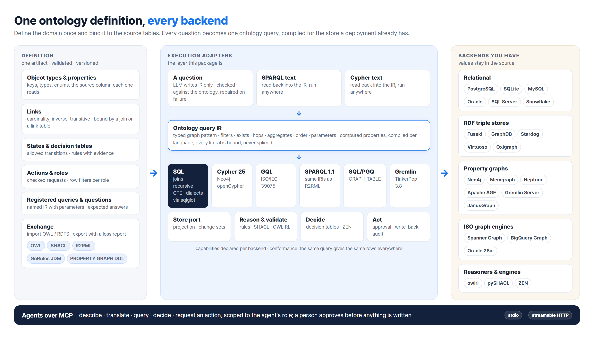
</p>

## Modules

Ontlas is one product in five parts, each named for what it does. They share one definition, so a part is a way in, not a
separate copy.

| Module | What it does | Where it is on the page |
|---|---|---|
| **Ontlas Studio** | Define and check: Objects, the Entities under them and their properties and relations, the workspace, validation questions and the flow's pass conditions | 온톨로지 매니저, 품질 관리 |
| **Ontlas Map** | Bind the definition to source tables, columns and codes, and to the words people use for it; check the definition against the database | 데이터 바인더, 시멘틱 매니저 › 용어사전 |
| **Ontlas Rule** | Formulas and decision criteria in three layers (AXIOM, Custom, Standard): rule cards, decision tables in plain words, parameters, functions and computed properties | 시멘틱 매니저 › 규칙 |
| **Ontlas Query** | Answers from checked definitions: one query compiled for whatever store a deployment has, search over documents and records, the REST API and MCP tools | 홈, 온톨로지 매니저 › 질의, 데이터 바인더 › 레코드 |
| **Ontlas Guard** | What people and agents may do: actions with criteria and approval, roles, masking and row scope, change requests tried on a copy before they apply, and the versions they make | 데이터 바인더 › 액션, 시멘틱 매니저 › 권한, 온톨로지 매니저 › 온톨로지 |

## What it is for

The space sits between the systems a business already runs and the people and agents that ask about them.

| Use | What it does |
|---|---|
| Search that goes on to the definition | Documents are searched by meaning on any vector store, each passage names the ontology elements it speaks of, and an object shows the documents that mention it |
| One shared definition | Objects, properties, relations, states, rules and roles are defined once over the source tables, in versioned module files a person can read and review |
| The same question on every store | One query compiles to SQL, Cypher, GQL, SPARQL, SQL/PGQ or Gremlin, and a conformance run compares the rows each store returns |
| Decisions with their grounds | Decision tables decide, not a language model; each answer carries the rule, the clause it cites, the source columns and the module version |
| Action under control | Roles scope rows and mask properties; an agent only files a request, nothing is written until a person approves it, and an executed action can be rolled back |
| Changes that are tried first | A new module version runs on a copy of the studio against the database check, backend agreement, validation questions and past decisions before it can be approved |
| One domain across systems and customers | A standard stays as it is; a new system gets a binding and a customer's differences get a module of their own (see [Adapt a domain](#adapt-a-domain)) |

A language model is optional. It turns plain questions into the ontology query and policy text into draft decision
tables, and the engine checks what it writes; the rest of the studio runs without one.

## What sets it apart

| Feature | How it works | Try it |
|---|---|---|
| One query, compared across stores | A query is a typed IR, not text. Compilers write each language, SPARQL and Cypher read back into the same IR, and a conformance run compares the rows store by store | `ontlas conformance examples/library/studio.yaml` |
| Standards that are never edited | Every element knows the module it came from. A customer's difference extends or removes from a module of its own, and detaching a module shows what would go before anything goes | `ontlas modules examples/library/studio.yaml --impact fashion` |
| Anything goes in, one JSON comes out | SQL scripts, ERD files, definition sheets, glossaries, message lists, Word, PowerPoint, Hangul and PDF documents all roll up into one JSON, and the same path makes modules from it | `ontlas ingest examples/definitions/*.csv -o bundle.json` |
| A studio from what already exists | Drafts come from data, from table and code definitions with no rows, or onto a standard, and keep the reason for each choice. Composite keys and references stay whole | `ontlas draft examples/files/*.csv -o my-studio` |
| Answers that show their grounds | A decision gives the rule that fired, the clause it cites and the source column of each input. A question counts as grounded only when its answer has all of them and the version, and that share can be a pass condition | `ontlas decide examples/library/studio.yaml returnEligibility I1001` |
| Rules checked against what was decided | Past cases are decided again with the values they had then, and the ones that differ are listed with the rule that fired | `ontlas agreement examples/library/studio.yaml` |
| Changes tried before they count | A new module version runs on a copy of the studio, and it can be approved only when it passes the flow's conditions | `ontlas review examples/library/studio.yaml acme-1.1.0.yaml` |
| Edits that say what they take | Removing a property or a relation in the modelling workspace takes out the queries, decisions and questions that need it, and lists them before anything is filed; an element carries a status (초안 · 사용 중 · 폐기 예정) | The page's 온톨로지 매니저 › 그래프 탐색 |
| Agents inside limits | Every MCP call runs inside the role's row filters and masks. An agent files a request, and nothing is written until a person approves it | `ontlas mcp examples/commerce/studio.yaml --role customer_agent --principal customer_id=C001` |
| Nothing to run first | The core has no required dependencies. SQLite and an in-process RDF graph are enough to try everything, and values stay in the source unless you ask for a projection | `python examples/commerce/demo.py` |

## How to use it

The walk-through runs on the examples in the repository, so take a checkout (`pip install "ontlas[all]"` installs the
same package without them).

```bash
git clone https://github.com/PlateerLab/ontlas.git
cd ontlas
pip install -e ".[all]"
```

**1. See it working.** The example library is one fictional shop: a commerce standard, its operations (sellers, payments,
refunds, shipping, coupons, reviews), a fashion extension and one customer's differences.

```bash
ontlas serve examples/library/studio.yaml --samples examples/files --policies examples/policies
```

Open http://127.0.0.1:7710. Each visitor gets a studio of their own, and the library folder is not written. The home
shows where the space stands: the version applied, how far its Entities have come (L0 to L3), the milestones and its
four parts (rules, ontology, data binding, quality), each leading to its screens. The sidebar holds the same four parts,
시멘틱 매니저, 온톨로지 매니저, 데이터 바인더 and 품질 관리, between 홈 and 운영.

**2. Define the ontology (온톨로지 매니저).** A definition has three levels: an **Object** is a top-level classification
(주문, 상품, 결제: an area of the business with a definition of its own), an **Entity** is a concept under it (주문, 주문상품)
and a **property** is a value an Entity carries. None of it needs data. Start by hand (오브젝트 관리 › 새 Object, then
+ Entity under it), from a standard module in the library, or from documents and data (step 4's draft). 오브젝트 관리
lists the Objects with their tier, owner and maturity. The workspace (그래프 탐색, its table view on 엔티티 관리) holds the canvas in the middle, the tree on the left (by Object, or by module) and the picked element's form, data,
uses, YAML and comments on the right, all of the same element. Each Entity shows how far it has come: L0 개념
(defined), L1 논리 (properties or relations), L2 연결 (bound to a table and its columns), L3 검증 (the database check finds
nothing against it). Draw a relation from a card's + to another card, drop a source column on a card to make a
property, give an element a status (초안 · 사용 중 · 폐기 예정) and take back any one edit. 검토 후 적용 first shows the
pending edits, what they reach and a run on a copy of the space; [적용] (in a team, the change request) is pressed
there. The canvas lays the cards out for its width and zooms with the wheel.

**3. Rules (시멘틱 매니저).** 규칙 opens on the three layers a rule
belongs to, AXIOM (laws and integrity, checked first), Custom (a customer's) and Standard (the common ones), with their
rule cards (see [Rules in three layers](#rules-in-three-layers)); every decision shows the path it took through them. A decision table is edited where it stands: cells in place and in plain words ("14일 이하",
"NORMAL 아님", "A, B 중", "값 없음" set the comparison and the value together), rows by dragging, the hit policy and the
modules in the header, overlaps and gaps above the table. Change the number in a condition and the reasons that still
say the old number are named, with one press to change them too. The simulator decides a record or typed values on the
table as edited and says which single change would turn the answer; the tests recompute past cases, generate boundary
values and run the validation questions on the edited table. 함수 is a tab beside it, 규칙 생성 에이전트 drafts a table
from policy text, and 용어사전 keeps what people call each definition.

**4. Connect data (데이터 바인더), when you want live values.** Definitions, rules and decisions on typed values
work without it. Drop files or whole folders in the catalog, or connect a database on DB 연결; each file says what it
became (table data, a definition sheet, a document, raw material), and a file read as something else is read again
as what you say it is. 초안 생성 turns the files into proposals reviewed step by step: every table scored against the
standards and bound to one or kept as a new Entity, English names from the standards and glossaries, a decision table
drawn from a column of past outcomes, and the module files applying would write. In a team the editor's last step
is 적용 요청 and an approver applies it. DB 대조 checks the definition against the database. From the command line:

```bash
ontlas draft examples/files/*.csv --name shop --label "가상 쇼핑몰" --lang ko -o my-studio    # from files
ontlas draft --definitions 테이블정의서.csv --definitions 코드정의서.csv --name shop -o my-studio   # from definitions, no rows
ontlas draft --definitions schema.sql --definitions 코드정의서.xlsx --name shop -o my-studio       # from a SQL script
ontlas draft --dsn "$ONTLAS_DSN" --name shop -o my-studio                                     # from a database
ontlas serve my-studio/studio.yaml
```

A database needs `pip install "ontlas[postgres]"` (or `[mysql]`, `[oracle]`, `[mssql]`). A draft reads every table in full to
profile it, so point it at a copy or a replica with a read-only account, not at a busy production database.

**5. Check it (품질 관리).** Validation questions with known answers (a passing one is one line; the ones that fail
show the expected and the given answer), by type (정의 · 판정 · 값) and with a held-out set reported apart, the backends
compared query by query, and the flow's pass conditions, measured; 흐름 shows every stage from the source to the
questions and sets the conditions.

```bash
ontlas bindings my-studio/studio.yaml       # the definition against the database
ontlas questions my-studio/studio.yaml      # validation questions: right, and grounded
ontlas conformance my-studio/studio.yaml    # every registered query on every backend
ontlas gates my-studio/studio.yaml          # the flow's pass conditions, measured
```

**6. Review and approve (온톨로지 매니저 › 온톨로지).** A change request is reviewed element by element: each element's
fields before and after (or the module file), what reads it, the pass conditions as the studio meets them now beside
the trial copy, the regression (questions the change newly fails or fixes), and comments that stay on the element.
Every approved change makes a new version of the space, listed on 판본 이력. Every element is marked before the request can be approved, and
the author cannot approve their own. 라이브러리 applies and removes modules; a module, a kind or a rule named anywhere
on the page leads to it. The same review from the command line:

```bash
ontlas review examples/library/studio.yaml acme-1.1.0.yaml   # a module version tried on a copy, against the flow's conditions
```

**7. Use it and plug it in (홈, 운영 › 저장소 · 연동).** The people who use the ontology start on 홈, with 할 일 one press
away in the top bar;
ask in one box and get the answer with how the question was read, where the answer came from and what to do next; open
a record's page; grow the graph from one record (each type its own colour and shape) and keep a perspective for the
team, bound to a role. `ontlas serve --users` gives a team one studio with roles (see [A team studio](#a-team-studio)),
and `ontlas mcp` and the token REST API give agents and platforms the same studio inside a role (see
[Agents over MCP](#agents-over-mcp)).

```bash
ontlas run examples/library/studio.yaml revenueByCategory
ontlas translate examples/commerce/ontology.yaml revenueByCategory --to cypher
ontlas decide examples/library/studio.yaml returnEligibility I1001
```

The sidebar has 홈, the four parts a space is made of (시멘틱 매니저 · 온톨로지 매니저 · 데이터 바인더 · 품질 관리) and
운영. A part opens to its screens, and a screen's own views are tabs on its page. A card at the top of the sidebar names
the space, its modules and source and switches the data; its foot shows how far the definition has come (L0 to L3). A
card's notes fold behind its (i) and the help drawer can show them all; `Ctrl K`, or the box in the top bar, jumps to
any screen, Object definition, decision table or query, or asks the words as a question:

| Part | Screen | Tabs | Use it to |
|---|---|---|---|
| 홈 | 홈 | 할 일 | Search or ask from one box; see the version applied, the Entities per maturity level, the milestones and the four parts with their status, an Object map, what waits on you, the pass conditions in brief, the records opened most and the registered queries; choose how to start when nothing is defined. 할 일 (also in the top bar) settles what waits for a person: action requests, change requests, draft apply requests, source conflicts to pick, check warnings and edits not filed yet |
| 시멘틱 매니저 | 규칙 | 계층 · 규칙 카드 · 결정표 · 기준값 · 지표 · 함수 | See the rules by layer (AXIOM, Custom, Standard) with their rule cards and the AXIOM value checks; edit and try decision tables, named values, metrics and functions (see step 3) |
| | 용어사전 | | Keep what people call each definition: preferred and English labels, synonyms, abbreviations, each screen's own word and the pairs not to swap; bring a glossary in |
| | 규칙 생성 에이전트 | | Draft a decision table from policy text, with the clause each rule came from, and file it as a change |
| | 권한 | | Change roles, their row scope and masks on forms |
| 온톨로지 매니저 | 오브젝트 관리 | | List the Objects with their definition, tier, owner and maturity; open one with its Entities, relations, decision tables, questions, source and version |
| | 엔티티 관리 | Entity · 속성 · 관계 · 상태 전이 | Change Entities, properties and relations in three columns, and states on forms |
| | 그래프 탐색 | 다이어그램 · 전체 보기 | Define on the canvas, the tree and the forms (see step 2), and see the whole definition as cards grouped by Object |
| | 문서 | | See documents as sections and concepts, and the relations a model finds between concepts |
| | 질의 | | Run a query, see it in each language, and ask in plain language when a model is connected |
| | 온톨로지 | 변경 요청 · 판본 이력 · 모듈 라이브러리 | Review changes element by element with their regression, see every version of the space, and apply or remove modules (see step 6) |
| 데이터 바인더 | 데이터 가져오기 | 재료 카탈로그 · DB 연결 · 초안 생성 · 변환 결과 | Bring files and databases in and draft from them (see step 4) |
| | 데이터 매핑 | 데이터 소스 · DB 대조 | See the source's tables, keys and references, and check the definition against them |
| | 액션 | 액션 정의 · 처리 요청 | Define actions; decide a case with its grounds and the path it took through the layers, request an action, approve it, roll it back |
| | 레코드 | 레코드 탐색 · 레코드 그래프 | Find and open a record (values, state, linked records, decisions, actions, documents, history); grow the graph from one record and keep a perspective |
| 품질 관리 | 검증질문 관리 | | Run the questions with known answers, by type and with the held-out set apart; add, move or remove them (see step 5) |
| | 검증 | 흐름 · 통과 조건 · 질문해 보기 | Set the pass conditions stage by stage; ask one question over decisions, data and documents and keep an answer judged right as a validation question |
| 운영 | 저장소 · 연동 | 어댑터 · 벡터 · 임베딩 · 외부 연동 | See every swappable part as measured, the embedding model and vector stores, and how MCP, REST and a platform's connection plug the space in |
| | 파이프라인 관제 | | See the whole pipeline as six floors, live, and where it stops when a stage fails |
| | 데이터 지도 | 자산 탐색기 · 자산 그래프 | Browse everything the space holds, and see how files, tables, documents, stores, Entities and queries connect |
| | 사용 안내 | | Read what each screen is for and how to use it, beside the demo video |

## What it looks like

The screens below are the example library in `examples/library` (common concepts, commerce and its operations, a
fashion extension, one customer's differences, and the bindings to one database), rendered by `tools/render_screens.py`
from `ontlas preview` and from a running `ontlas serve`. Nothing on them is drawn by hand: the modules, the compiled
queries, the rows from both backends, the decision with its evidence and the reach of a column change are what the
library computed for that example.

<p align="center">
  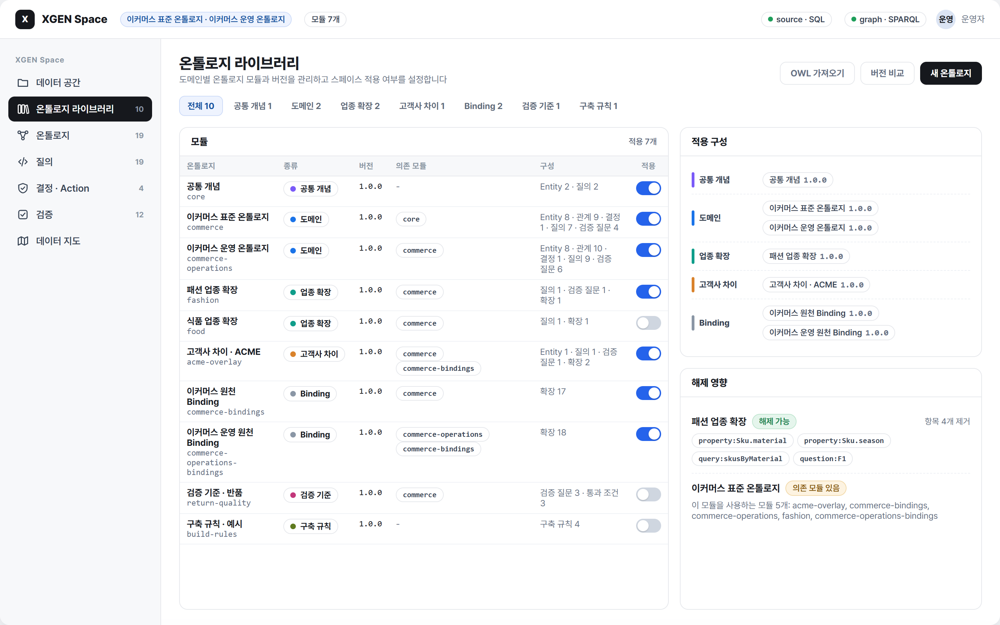
</p>

<p align="center"><b>The ontology library.</b> Commerce and every domain added later live as separate, versioned packages;
a studio plugs in the ones it needs, and the screen shows what unplugging one would take away before it happens.</p>

<table>
  <tr>
    <td width="50%">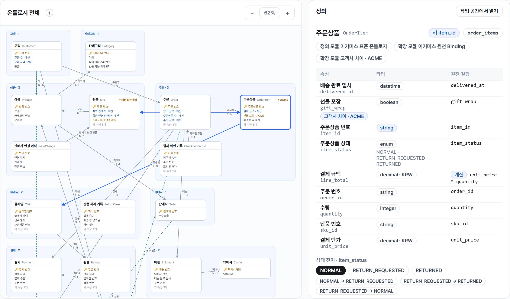</td>
    <td width="50%">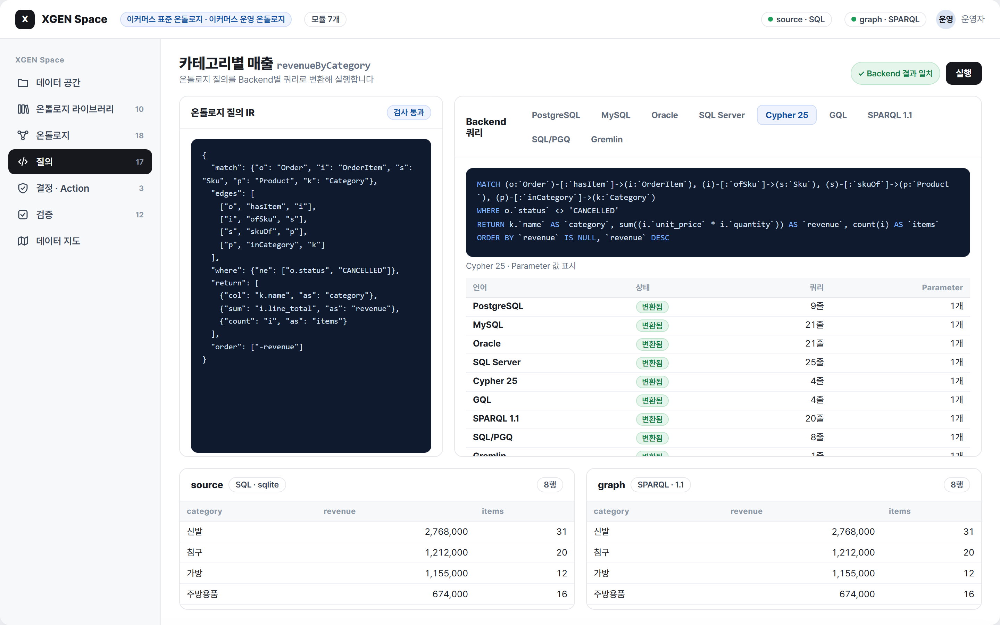</td>
  </tr>
  <tr>
    <td><b>Ontology.</b> Every object as a card with its key, representative and computed properties, in a region per module, with relations named and sized; press a card and what it connects to gathers around it, the rest fading. Domain types hang under common concepts (customer and seller under party, order under agreement).</td>
    <td><b>One query, every language.</b> The ontology query, its text for PostgreSQL, MySQL, Oracle, SQL Server, Cypher 25, GQL, SPARQL, SQL/PGQ and Gremlin, and the rows from each backend side by side.</td>
  </tr>
  <tr>
    <td>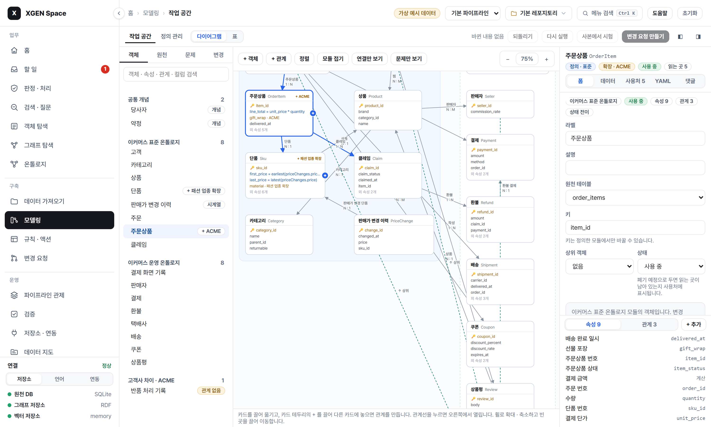</td>
    <td>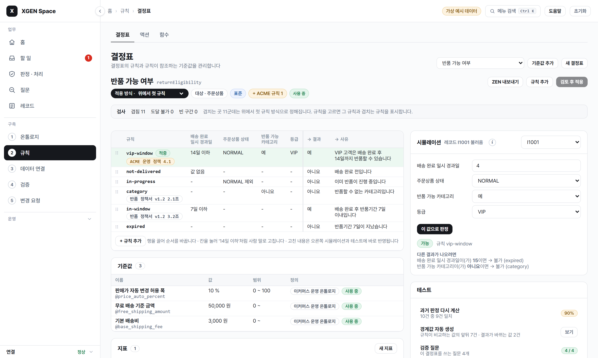</td>
  </tr>
  <tr>
    <td><b>Model.</b> The workspace: cards on a canvas, a tree by module, and the picked object's form, data, uses, YAML and comments. Draw a relation from card to card, drop a column on a card, give an element a status, try the edits on a copy, file them.</td>
    <td><b>Rules.</b> A decision table edited where it stands, checked for overlaps and gaps as it is edited, and tried on a record with what single change would turn the answer.</td>
  </tr>
  <tr>
    <td>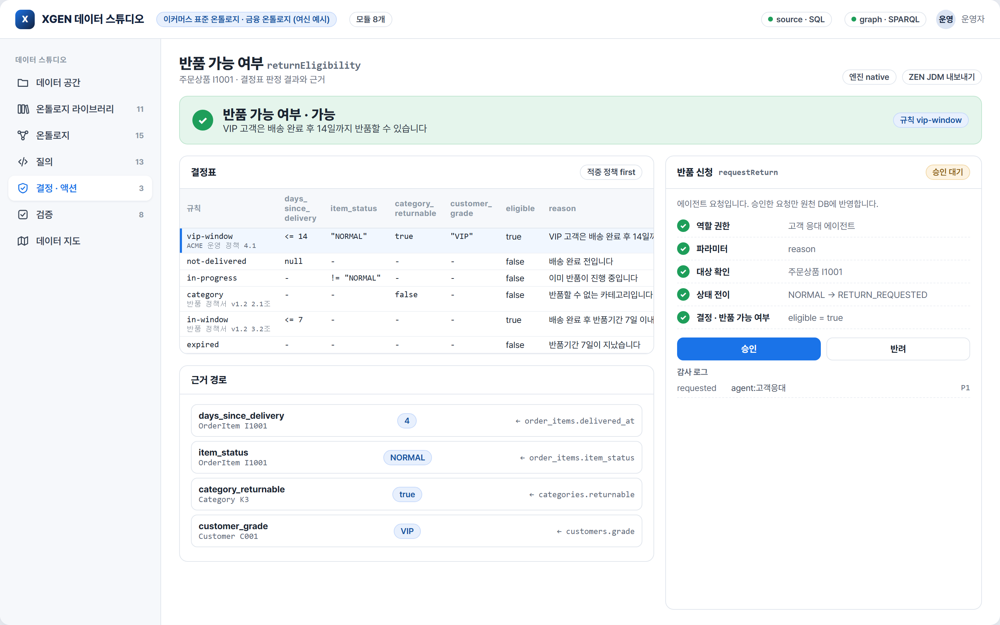</td>
    <td>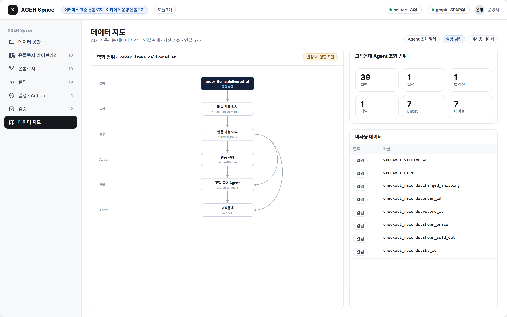</td>
  </tr>
  <tr>
    <td><b>Decide and act.</b> A decision table (here with the customer's own VIP rule plugged in ahead of the standard ones, each rule citing its policy), the source column behind every input, and an agent's action request waiting for a person.</td>
    <td><b>The data map.</b> What a column change touches, from property to agent; what one agent can reach; what nobody uses.</td>
  </tr>
  <tr>
    <td>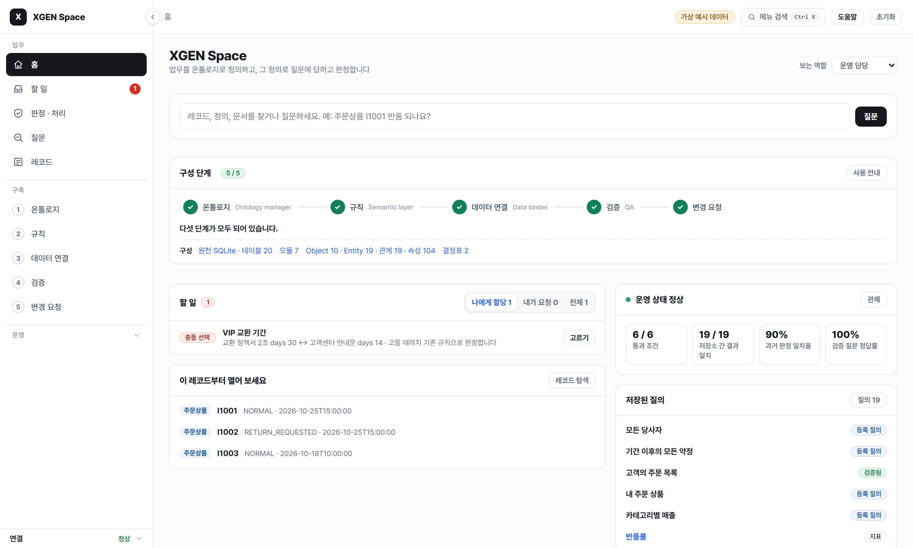</td>
    <td>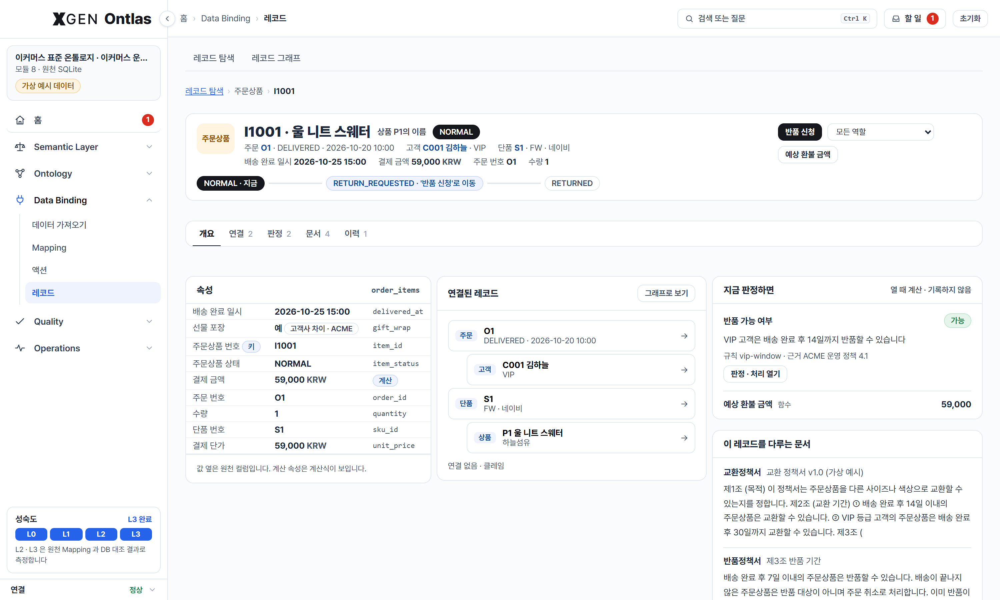</td>
  </tr>
  <tr>
    <td><b>Home.</b> Where the space stands and where its people start: the version applied, how far its Entities have come, the milestones and its four parts (rules, ontology, data binding, quality) with their status, a box to search or ask, what waits on them, the measured pass conditions and an Object map, laid out for the role they pick.</td>
    <td><b>A record.</b> Values with their columns, the state machine's current and next steps, the actions a role may take, linked records, what the decisions say of it now, the documents that name it, and its history.</td>
  </tr>
  <tr>
    <td>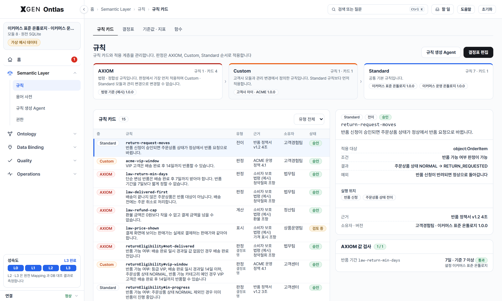</td>
    <td>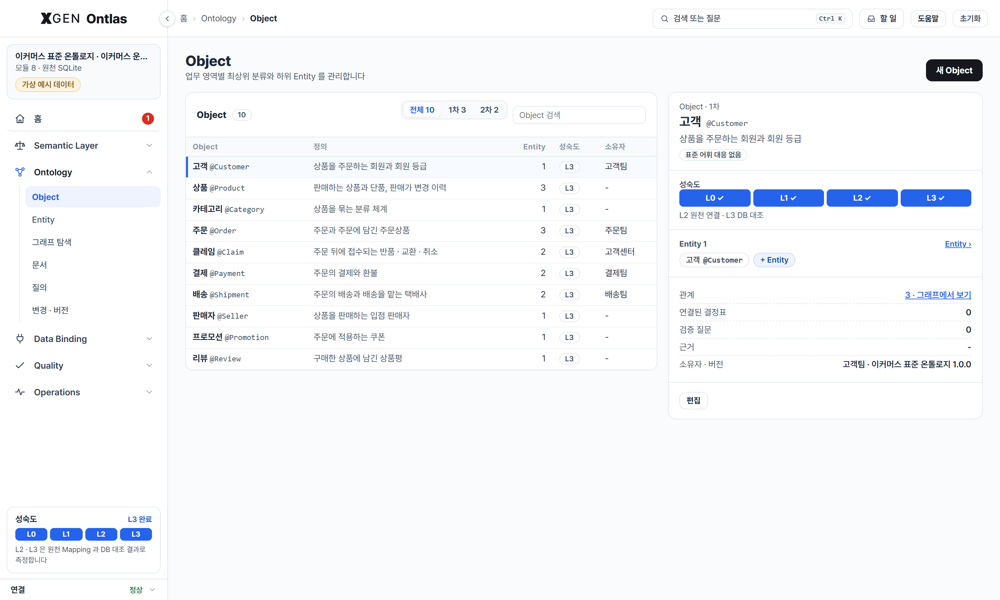</td>
  </tr>
  <tr>
    <td><b>Rules in three layers.</b> AXIOM (laws and integrity, checked first), a customer's Custom rules and the common Standard ones, each with the modules that wrote them; every rule card with its statement, source, owner and status, and the AXIOM checks on the values in force.</td>
    <td><b>Objects.</b> The top-level classifications with their definition, tier, owner and how far their Entities have come (L0 to L3); one opened shows its Entities, relations, decision tables, questions, source and version.</td>
  </tr>
</table>

## The pieces

| Module | What it does |
|---|---|
| `model` · `validate` | The definition: object types (key, table, properties with type, enum values and column), links (`on` a join or `via` a link table; cardinality, inverse, transitive, symmetric, required), interfaces, state machines, decision tables, actions, roles with row filters, registered queries and validation questions. JSON or YAML, checked for consistency before anything runs |
| `expr` | Computed properties: arithmetic, comparisons and functions over an object's properties, aggregates along links (`sum(hasItem.line_total)`) and the latest or earliest value of a series, typed and checked, compiled into SQL, SPARQL and Cypher (GQL and SQL/PGQ take the ones without links and dates) |
| `modules` · `library` | Domain knowledge as packages: common concepts, domains, industry extensions, one customer's differences and the bindings to a database, each versioned and kept apart in a library, composed in requirement order with the origin of every element recorded, plugged in and out at run time and swapped for an edited version; an overlay holds modules in memory over a library folder |
| `draft` · `induce` · `mapping` | Files (CSV, TSV, Excel) and databases (SQLite, PostgreSQL) read into a drafted definition and its bindings: objects, keys, types, allowed values, relations, state machines from a history table, actions, roles, questions and queries, each with its reason; a decision table drawn from past outcomes; or the tables bound onto a standard module instead of becoming new types |
| `review` | The flow's stages and pass conditions, agreement with past decisions, and change requests: a new module version tried on a copy of the studio, reviewed against the conditions, approved by another person, saved as a version |
| `identity` | Records that several systems keep under their own keys, joined by match rules into one object with a crosswalk, with the evidence for every join |
| `bindings` | The definition checked against the actual database: tables and columns, types, duplicate keys, missing required values, enum values the definition does not know, links that point at nothing |
| `ir` · `check` | The ontology query: a typed graph pattern with filters, `exists`, multi-hop links, aggregates, order and parameters. The check resolves link direction (inverse names included), types every literal and parameter, and explains what is wrong in plain sentences |
| `compile` | One compiler per language: SQL (PostgreSQL and SQLite natively, every other dialect through sqlglot), Cypher 25, ISO GQL, SPARQL 1.1, SQL/PGQ, and the `CREATE PROPERTY GRAPH` for the bound tables. Literals are always bound as parameters; NULLs sort last everywhere |
| `parse` | SPARQL and Cypher read back into the IR, so a query in either runs on any backend |
| `backends` | SQLite, any DB-API connection, rdflib, any SPARQL 1.1 endpoint, Neo4j, Gremlin Server, and a callable adapter for engines without a driver here. Each declares what it can do |
| `projection` | Source rows to RDF triples or property-graph nodes and edges, and the change set between two projections for incremental loads |
| `decide` · `actions` · `roles` | Decision tables with evidence, exported to GoRules JDM and run on ZEN; actions with checked parameter values, human approval, write-back, an external request to allowed hosts, rollback and an audit trail; role scoping of every query and tool, with masked properties |
| `reason` | Inverse, symmetric and transitive links derived with their reasons; shape checks; SHACL generated and validated; OWL 2 RL materialization |
| `exchange` | OWL and R2RML export with a report of what each format cannot hold; OWL/RDFS import as a starting definition |
| `catalog` | The data space as a graph: databases, tables, columns, files, collections, ontology objects, queries, decisions, actions, roles, agents |
| `nl` | A schema card and IR guide for a language model, and a loop that checks its answer and asks again with the issues |
| `conformance` · `studio` · `cli` · `mcp_server` · `preview` | Runs across backends compared row for row; the facade; the `ontlas` command; the MCP server; the studio page as a file |
| `repository` | Repositories of raw files: folders and files by path in an index, bytes by hash, kept in a folder or gone with the visitor |
| `web` | The studio page served over HTTP with the standard library only: the pipeline board, flow with its pass conditions, the data catalog, the one JSON, the draft and standard bindings, library with the module editor and change review, ontology graph, queries, decisions, approvals and rollback, checks, and the guide with its video; one studio per visitor, or one per team behind a sign-in |

## Define once

```yaml
areas:                      # the top level (shown as Object): an area of the business with a definition of its own
  Order: {label: 주문, description: 주문과 주문에 담긴 주문상품, aligned: [https://schema.org/Order]}
objects:                    # the concepts under it (shown as Entity)
  OrderItem:
    label: 주문상품
    area: Order
    source: {table: order_items}
    key: item_id
    properties:
      delivered_at: {type: datetime, label: 배송 완료 일시}
      item_status:  {type: enum, values: [NORMAL, RETURN_REQUESTED, RETURNED]}
    states: {property: item_status, initial: NORMAL, transitions: [{from: NORMAL, to: RETURN_REQUESTED}]}
links:
  hasItem: {from: Order, to: OrderItem, cardinality: one_to_many, on: {order_id: order_id}, inverse: itemOf}
decisions:
  returnEligibility:
    target: OrderItem
    inputs:
      days_since_delivery: {type: integer, days_since: delivered_at}
      category_returnable: {type: boolean, path: [ofSku, skuOf, inCategory], property: returnable}
    outputs: {eligible: boolean, reason: string}
    rules:
      - {when: {days_since_delivery: "null"}, then: {eligible: false, reason: 배송 완료 전입니다}}
      - {when: {category_returnable: "false"}, then: {eligible: false, reason: 반품할 수 없는 카테고리입니다}}
      - {when: {days_since_delivery: "<= 7"}, then: {eligible: true, reason: 반품기간 7일 이내입니다}}
roles:
  customer_agent:
    read: [Order, OrderItem]
    row_filters:
      Order: {eq: [$self.customer_id, {principal: customer_id}]}
```

The full example is [`examples/commerce/ontology.yaml`](https://github.com/PlateerLab/ontlas/blob/main/examples/commerce/ontology.yaml): eight object types
(one of them a price history), nine links, eight computed properties, a decision, an action, three roles, twelve
registered queries and seven validation questions.
An object type with no `source` is a definition only: its decisions take typed values, and it binds to a table later
without being written again. `areas` and `area` are optional; a definition without them is grouped by module.
Decision cells are a small FEEL subset: `-`, `null`, `not null`, `<= 7`, `[1..7]`, `"VIP"`, `!= "NORMAL"`,
`in ["A", "B"]`, `true`.

A column that needs changing on its way in takes a `transform` over `value`. Every language reads the changed value, a graph holds
the stored one, and an action cannot write it back:

```yaml
price:   {type: decimal, column: price_cents, transform: "value / 100", source_type: integer}
on_sale: {type: boolean, column: on_sale_yn, transform: "value = 'Y'", source_type: string}
```

An interface is queried like a parent type. `{match: {x: Named}, return: [x.name]}` reads every type that implements it, on every
store, and a role reads through it only if it reads each of those types without a row limit. Its properties keep the same name on
each type and are stored, not computed.

## Computed properties and series

```yaml
OrderItem:
  properties:
    line_total: {type: decimal, expr: "unit_price * quantity"}
Order:
  properties:
    total:  {type: decimal, expr: "coalesce(sum(hasItem.line_total), 0)"}
    billed: {type: decimal, expr: "if(status = 'CANCELLED', 0, total)"}
PriceChange:
  series: {time: changed_at, of: priceOf}        # observations over time
Sku:
  properties:
    last_price: {type: decimal, expr: "latest(priceChanges.price)"}
```

A computed property is asked for like any other (`o.total`, in IR, SPARQL or Cypher) and compiled into each
language: a scalar subquery in SQL, `BIND` and a grouped subquery in SPARQL, a pattern comprehension in Cypher. It is
never copied into a graph, so the conformance run compares the expression itself across backends. Nulls follow one
rule everywhere (division by zero and an `if` on a null condition give null). Functions: `coalesce`, `if`, `abs`,
`round`, `floor`, `ceil`, `lower`, `upper`, `length`, `concat`, `year`, `month`, `day`, `days_between`; aggregates
along a link path: `sum`, `avg`, `min`, `max`, `count`, and `latest` / `earliest` on a series. A language that has no
form for one says so before it runs.

## Swap anything: the ports

<p align="center">
  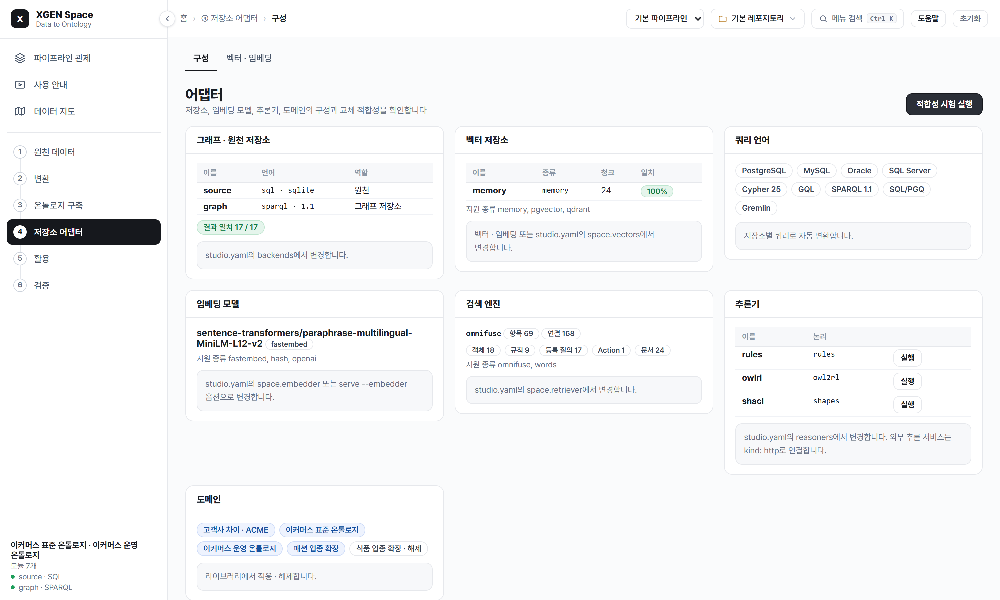
</p>

Every part a deployment might want different is a port with a small interface, a registry, and a test that says the swap
changed nothing.

| Port | In the package | Add your own | The test |
|---|---|---|---|
| Query backends | SQLite, PostgreSQL, MySQL, Oracle, SQL Server, any DB-API, rdflib, SPARQL endpoints, Neo4j, Gremlin, a query gateway | `kind: dbapi`, or a `Backend` | `ontlas conformance`: the same rows on every store |
| Vector stores | memory (exact), Qdrant, pgvector | `register_vector_store` | `ontlas vectors`: every store against exact search |
| Embedders | hash (no model), any OpenAI-shaped service, fastembed (a local multilingual model) | `register_embedder` | Search checks in `space.checks`, a pass condition of the flow |
| Reasoners | rules, owlrl, shacl, reasonable, any HTTP service that takes and returns turtle | `register_reasoner` | `ontlas reasoners`: engines of one logic must derive the same facts |
| Relation readers | basic (any chat model), xgen-ontology-build's relation formation | `register_reader` | Both read the same passages; every relation's two ends are concepts its sentence names |
| Domains | modules in a library | a package | Validation questions and the flow's conditions |

Two OWL 2 RL engines run side by side is how `reasonable` 0.4.4 was found to join every subject of an inverse functional
property with `sameAs`. It stays available and off the default list. That is what the comparison is for.

```yaml
space:
  embedder: {kind: openai, url: https://models.example/v1, model: bge-m3, key_env: EMBED_KEY}
  vectors:
    main: {kind: qdrant, url: http://localhost:6333}
    pg:   {kind: pgvector, dsn: "${ONTLAS_PG}"}      # every store holds the same chunks
  documents: ["docs/*.md", "policies/*.pdf"]
  checks:
    - {text: 택배가 일주일째 안 와요, document: 배송안내}   # the flow's index stage: found in the top five?
reasoners:
  rl: {kind: owlrl}
  theirs: {kind: http, url: https://reasoner.example/infer}
```

## Documents in the space

A document that comes in, through the catalog or `space.documents`, goes two ways at once.

- **Vectors.** It is cut at sections and sentences, embedded, and written to every vector store. Only what changed is embedded; a store that missed a round catches up on the next one. Every vector carries the folder its file is in and the model that made it. A file's embedding can be turned off in the catalog: its documents leave the stores, and so the search, and stay in the document ontology.
- **Document ontology.** It becomes rows of document, section and concept. Concepts are the names the definitions give (objects, properties, allowed values, decisions, glossary terms) plus the words a document keeps returning to, found without a model. The rows run on the same engine as the domain ontology, so the same compilers and the same conformance apply.
- **Relations, when asked.** With a model connected, 관계 추출 sends the sentences that name two concepts or more to a reader, their concepts numbered, and keeps a relation only between concepts its sentence names, with that sentence. Relations join the document ontology (`relationsOf`, `relationNames`) and its graph, and an answer lists the ones its shown passages state. They do not change which passages a search finds: on a set of 100 relation questions the ranks were the same with and without them. Readers are a port: `basic` needs only the model, `ontology-build` is xgen-ontology-build's relation formation (`pip install "ontlas[build]"`). A reading runs on the server, stops and resumes, covers a folder or everything, and with `--repositories` is kept next to them; a passage that changes is read again.

<table>
  <tr>
    <td width="50%">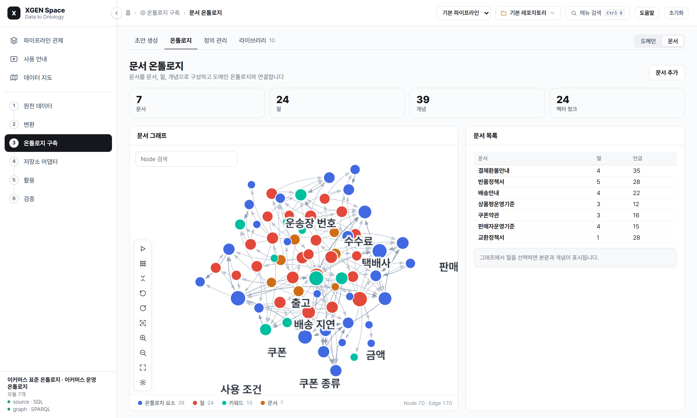</td>
    <td width="50%">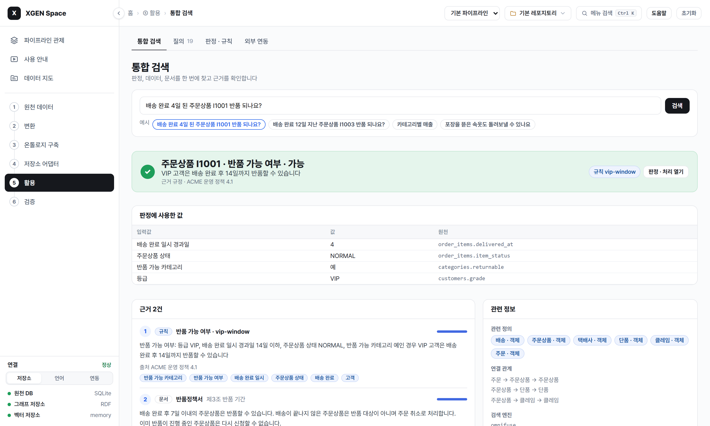</td>
  </tr>
</table>

A search takes more passages from the store than it returns and orders them by the model's score and the question's own
words, since the nearest passage to a model is not always the one that says it.

Concepts tie the two together. `ontlas search` returns the passages and the definitions a question names, the object screen
shows the sections that mention an object, and the map shows which queries a document touches. Without a reading, concepts are tied
by co-mention only: two names in one section. A relation a reader found replaces the co-mention between its two concepts.

Folders are ranges. A search, a question (`folder` on `POST /v1/search` and `POST /v1/answer`, and on the MCP tools), the document
graph and a reading keep to one folder and the folders under it, and a role's `documents` take file paths and patterns such as
`정책/*` besides document names.

Vectors of two models do not compare, so changing the embedding model embeds every passage again. On 벡터 · 임베딩 a change first
lists what it embeds again (documents, passages, characters) and the time it takes, measured on a few passages with the new model;
the stores are emptied and filled again only when you go ahead. A model that fails leaves the stores as they were, and the files
it could not embed say so.

## One question over everything

Definitions and rules from the ontology and passages from the documents sit in one index, so a rule and the clause it cites land
side by side. How the index is searched is a port, `space.retriever`: `omnifuse` fuses lexical and dense seeds with the graph between
the entries (`pip install "ontlas[omnifuse]"`), and `words` needs nothing beyond the space. With nothing said, the best one
installed is used.

A question then goes to whatever can settle it, and a model is the last resort:

| The question has | What answers | A model? |
|---|---|---|
| a key and a decision's name: `주문상품 I1001 반품 되나요?` | the decision table, with the rule, the source values and the clause | no |
| a key alone | the record, under the role's limits and masks | no |
| a registered query's name | the query | no |
| anything else | rules and passages found; a data question becomes a query | words only what was found |

The page's 통합 검색, `POST /v1/answer` and the MCP tool `answer_question` are the same code. `ontlas compare` puts one question file to
one model three ways, with nothing, with the documents alone and through the space, and counts the right answers. What is right comes
from the file, not from a model:

```bash
ontlas compare examples/library/studio.yaml examples/library/answers.yaml --llm-url https://models.example/v1 --llm-model my-model
```

## Plug domains in and out

Domain knowledge comes and goes, so it is packaged. A library keeps each package apart as
`<name>/<version>.yaml`; a studio composes the ones it needs.

| Kind | Example | What it holds |
|---|---|---|
| `core` | `core` (공통 개념) | Concepts every domain hangs from: party, agreement, the `Named` interface |
| `domain` | `commerce`, `commerce-operations` | The standard definition of a domain, aligned to schema.org or GS1, with no tables in it |
| `industry` | `fashion`, `food` | What one industry adds on top of the standard: material and season, expiry and storage |
| `customer` | `acme-overlay` | Only what one customer does differently: an extra property, a VIP rule placed ahead of the standard ones, a query taken out |
| `binding` | `commerce-bindings` | The tables and columns of one database. Swap it, and the same definition reads another system |
| `quality` | `return-quality` | How a definition is checked: validation questions and the flow's pass conditions. Attached, it raises the studio's conditions where it asks more; detached, they go back |
| `method` | `build-rules` | How a draft is built from data: the draft rules (allowed-value limits, key, state and person hints) the data tab starts from |
| `dictionary` | a drafted `shop-dictionary` | A system's words and messages: a glossary finds the standard's names and reaches the language model's schema card, and a decision that answers with a message code shows the message |

```yaml
module: acme-overlay
kind: customer
requires: [commerce, commerce-bindings]
extend:
  objects:
    OrderItem: {properties: {gift_wrap: {type: boolean, label: 선물 포장}}}
  decisions:
    returnEligibility:
      inputs: {customer_grade: {type: string, path: [itemOf, placedBy], property: grade}}
      rules_prepend:
        - {id: vip-window, when: {customer_grade: '"VIP"', days_since_delivery: "<= 14"},
           then: {eligible: true, reason: VIP 고객은 14일까지 반품할 수 있습니다}, cite: ACME 운영 정책 4.1}
remove: {queries: [wishlistCount]}
```

```python
from ontlas.library import Library
lib = Library("examples/library")
studio = Studio.from_library(lib, ["commerce-operations-bindings", "fashion", "acme-overlay"])  # + requirements
db = studio.add_backend("source", SqliteBackend())
for seed in ("examples/commerce/seed.sql", "examples/library/seed_operations.sql"):
    db.script(open(seed, encoding="utf-8").read())

studio.composition.owner("property:OrderItem.gift_wrap")     # 'acme-overlay': every element knows its module
studio.detach_impact("fashion").removed                      # what would go, before anything goes
studio.detach("acme-overlay"); studio.attach("acme-overlay") # the VIP rule leaves and comes back
studio.detach("commerce")                                    # refused: three modules depend on it (cascade=True to take them too)
studio.run("allParties")                                     # one concept, two types: customers and sellers
studio.check_bindings()                                      # the definition against the actual database
```

A concept with no table of its own is asked through its subtypes: in SQL as the `UNION ALL` of their tables,
in SPARQL and Cypher through the concept's type or label, and the conformance run checks the answers agree.
`aligned` IRIs export as `skos:exactMatch`, `cite` as `dcterms:source`, the module as `rdfs:isDefinedBy`; an
imported standard keeps its original IRIs as alignments.

## Adapt a domain

Adapting a domain to a system means leaving its standard as it is and writing only what differs. Whatever you start
from, the result is the same kind of file, a module, so it is checked, reviewed, versioned, attached and detached like
the rest.

| You have | Path | It becomes |
|---|---|---|
| A standard that fits, and the system's tables | `mapping.suggest`, the page's "표준에 연결" | A `binding` module |
| Table and code definitions, a SQL script, an ERD file | `ontlas draft --definitions` | A definition and its `binding`, with no rows needed |
| A code definition whose codes refer to other codes | The same draft | Decision tables: what each code implies, or what each state allows |
| A glossary, a message list | The same draft | A `dictionary` module |
| Data files or a database | `ontlas draft` | A definition and its `binding` |
| Past outcomes | `induce`, the rules step of a draft | A decision table |
| Policy text, in any document format | `ontlas policy-draft`, the library's "정책서로 규칙 초안" | A module with a decision table, each rule citing its clause |
| An OWL or RDFS ontology | `ontlas import-owl` | A starting definition |
| Edits on the management screens | Objects, properties, relations, questions | The `workspace` module, of kind `customer` |
| Knowledge of the domain | A YAML file, or the library's module editor | A module of any kind |

A definition drafted from one system describes that system. To carry a domain across systems, bind the tables to a
standard instead: its queries, decisions and questions carry over, less what the tables do not hold. Matching goes by
names, labels and types, and a glossary says which of the system's words mean what the standard names (회원 is 고객).
A system that abbreviates its names still gets partial suggestions, and a person picks the rest: choosing another
table matches its columns and relations again.

A studio reads one source database today. A draft from definitions alone is checked against an empty database of
the same shape, which says nothing about real rows: for that, get read-only access to a development database.

### Anything in, one JSON

`ontlas ingest` reads each file through an adapter and rolls everything into one JSON, which `ontlas draft --definitions`
takes like any other input. On the page, the same adapters read what reaches the catalog, and 변환 결과 shows the JSON.

| Input | Read as |
|---|---|
| `.sql`, `.ddl` (PostgreSQL, MySQL, Oracle, SQL Server, SQLite) | Tables, keys, references, comments as names, `ENUM` and `CHECK ... IN` as allowed values |
| `.dbml`, `.pdm` (PowerDesigner), `.mwb` (MySQL Workbench) | The same, from the modelling tool's own file |
| `.db`, `.sqlite` | The tables, keys and references of a SQLite file |
| `.csv`, `.xlsx`: table, index, code, glossary and message sheets | By their headers, Korean or English, under a title and behind a cover sheet. Group rows and reference columns of a code definition are understood |
| `.docx`, `.pptx`, `.hwp`, `.hwpx`, `.pdf`, `.html`, `.md`, `.txt` | Text by section, for policy drafting (`.pdf` needs `[pdf]`). A `.hwp` with a password or a viewing-only copy is refused |
| `.json`, `.yaml`: OpenAPI 3 or Swagger 2 | Schemas as tables, `$ref` and lists as references, `enum` as code groups, operations as sections, and each writing operation as an action to review, behind a person's approval |
| `.json` | The same shape, written by hand or by another tool |

```json
{"tables": [{"name": "TB_ORDER", "label": "주문", "primary_key": ["ORDER_NO"],
             "columns": [{"name": "ORDER_NO", "label": "주문번호", "type": "varchar"}, {"name": "STAT_CD", "code": "OD01"}],
             "references": [{"columns": ["MEMBER_NO"], "table": "TB_MEMBER", "ref_columns": ["MEMBER_NO"]}]}],
 "codes": {"OD01": {"label": "주문상태", "values": [{"code": "10", "name": "주문접수"}]}},
 "terms": [{"term": "고객", "synonyms": ["회원"]}],
 "messages": [{"code": "MSG-RT-001", "text": "반품 가능 기간이 지났습니다."}],
 "documents": [{"name": "교환정책서", "kind": "policy", "text": "...", "sections": [{"title": "1. 반품 기간", "text": "..."}]}]}
```

A format with no adapter here goes through a plug-in: a Python file that calls `ingest.register([".ext"], fn)` and
returns `Definitions`, loaded with `ontlas ingest --adapter FILE` or `ONTLAS_ADAPTERS`. A binary format nothing reads is
refused with what to export it to.

## The pipeline board

What is wrong is said as something to act on (`GET issues`), the same on the board, the home, 할 일, 흐름 and 검증. An alert opens a
panel where it was pressed: the items behind it, why they came to be, what they reach and the ways to fix each, marked as fixed
here (in the workspace, then a change request), applied at once (taking a module off, shown first on a copy, or reading the source
again) or fixed at the source (with the list to hand over). Alerts that read the same broken column stand under one cause; a
failure is only gathered under another when what failed reads what is broken. Choosing a fix opens the field that mends it, with
a bar saying which problem this is and what is next, and when the change goes in the board measures again and the issue closes.
When each opened and closed is written to the journal.

관제, under 운영, draws the pipeline as a building: raw data at the bottom, then conversion,
the ontology, the storage adapters, its use, and verification at the top, with the data climbing one belt through the floors.

<p align="center">
  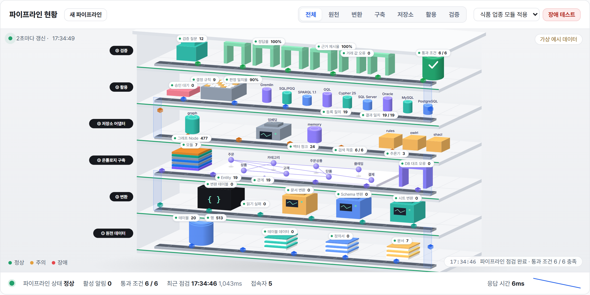
</p>

Nothing on it is scripted. Every number comes from the space as it is now, so it works on any ontology, including a
draft from your own files: tables and rows, files by kind, modules, objects and relations, query results compared across
backends, decision agreement, question accuracy, pass conditions. Numbers refresh every 2 seconds. The flow is measured
again as soon as the definition or the files change, and otherwise every 20 seconds while the board is open.

A stage that misses its pass conditions stops the data at its floor, and a failure that crosses floors is told as a chain
from where it shows down to the module that brought it:

```text
질의 ← DB 대조 ← 식품 업종 확장 모듈   (Sku.expires_on, Sku.storage)
```

To see that on the example library, choose 장애 테스트: it really applies a module whose columns the database does not have,
and 복구 takes it off again. A studio file names such modules itself:

```yaml
monitor:
  faults:
    - {label: 식품 업종 모듈 적용, attach: food}
```

Each draft you apply becomes a pipeline of its own. The 데이터 list at the top of the page switches between them, the one
you started with (기본 데이터) included, and 초기화 is no longer the only way back. A visitor keeps up to five.

## The data catalog

Raw material comes first. 데이터 카탈로그 keeps files in repositories, by folder, and says what each one turned out to be.

<p align="center">
  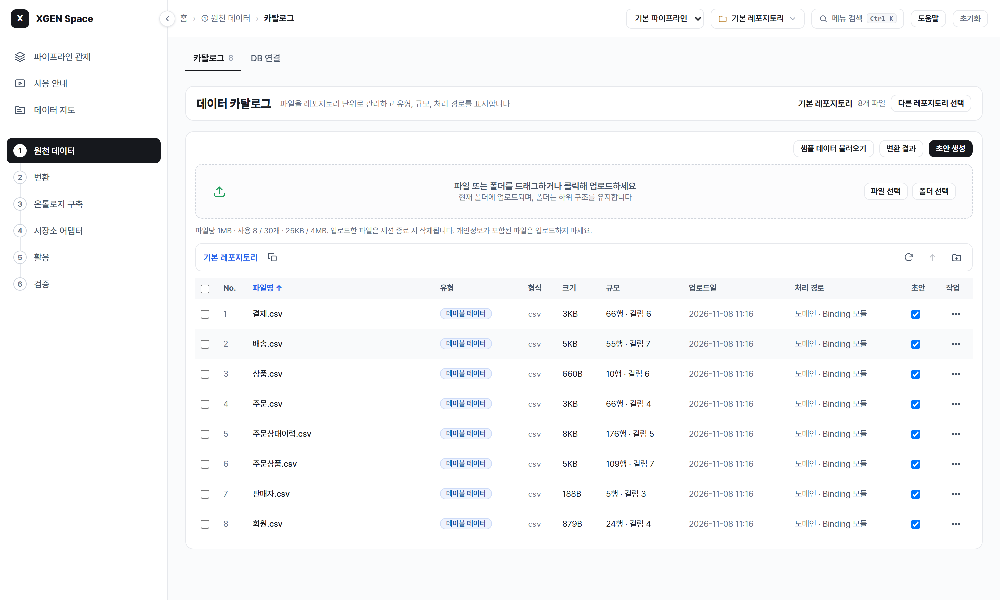
</p>

| You do | It does |
|---|---|
| Drop files or a whole folder | Uploads into the current folder and keeps the folder's structure. `.DS_Store`, `Thumbs.db` and Mac archive metadata stay out |
| Upload something it cannot read | Keeps the file and says why on its row. Images, video and archives are kept as they are, so a repository can hold everything a project has |
| Look at a row | Kind, size, rows or sections, and where it goes: a table or a definition sheet to the domain and binding modules, a code sheet to value names and decision tables, a glossary to the term dictionary, a document to the policy draft |
| Open a file | First rows or sections, its share of the JSON, and a download |
| Clear a file's or folder's 초안 box | Leaves it out of 변환 결과, the next draft, the search and the document ontology, and keeps it in the catalog |
| Clear a file's or folder's 임베딩 box | Takes its documents out of the vector stores, and so out of search; they stay in the draft and in the document ontology. Each row says 임베딩됨, 임베딩 대기, 임베딩 실패 or 꺼짐 |
| Switch repository | The draft reads that repository's files from then on |

A path in a repository is a name in an index, never a path on disk: the bytes are stored under their SHA-256, so nothing
a visitor types reaches the file system, and two copies of a file cost one.

Without `--repositories` the files go with the visitor's session, which suits a public demo. With it they stay in that
folder across restarts, one set for all visitors. `--file-kb`, `--max-files` and `--total-mb` set the limits, and
`--allow-connect` adds 경로 입력, which brings in a file or folder from the server's own disk.

```bash
ontlas serve studio.yaml --repositories ./repositories --file-kb 51200 --max-files 2000 --total-mb 4096 --allow-connect
```

## Start from your own data

A definition does not have to be written first. `ontlas draft` reads files or a database and drafts the two
modules a library expects, a definition and its bindings, keeping the reason for every choice:

| | How it is decided |
|---|---|
| Objects | One per table, after the W3C Direct Mapping; a table of two relation columns and nothing else becomes a many-to-many link instead |
| Keys | The declared primary key; for files, a column whose values are all present and distinct (a row number when none is) |
| Types | A database's declared types (ISO text in SQLite is read as dates); for files, the values: integers with or without thousands separators, decimals, dates, date-times, booleans. Values with leading zeros stay text, as codes |
| Allowed values | Text columns whose few values repeat |
| Relations | Declared foreign keys; otherwise a column named after another table's key (the same name, `<table>_<key>`, `<table>_id`) whose values are all found among that key's values. A key name many tables share, such as `id`, does not make a relation by its name alone |
| States | A status column (by the state name hints) with allowed values; a table that keeps past states of the same rows gives the transitions in the order they happened and the usual first state, and becomes a series. One action per state things move into |
| Roles | A viewer, an operator when there are actions, and for a person-like table (by the person name hints) a role that reads only one person's rows |
| Queries | A list per object, a count per relation and per allowed value, so a conformance run has something to compare from the start |
| Questions | Each generated query with the rows it gives now, to check later changes against |

```bash
ontlas draft members.csv products.csv orders.csv -o shop-demo   # shop-demo/library/, data.sqlite, studio.yaml
ontlas draft --sqlite shop.db --name shop                     # opened read-only; prints the two modules
ontlas draft --dsn "$ONTLAS_DSN" -o shop                         # the studio file reads ${ONTLAS_DSN}, not the password
ontlas draft *.csv --rules '{"enum_max": 10, "infer_links": false}' --drop object:Log -o shop-demo
ontlas serve shop-demo/studio.yaml
```

Nothing in the draft is fixed. The rules above are `DraftRules` (how many distinct values still make a category,
whether relations are inferred, whether link tables become many-to-many links, the name hints for titles, parents
and keys, which queries to generate), and `Draft.revise()` takes a person's edits on top: another key column, a
property's type and allowed values, labels, left-out objects, properties and queries, a relation's cardinality, a
relation added by hand. A type chosen for a file's column is how its values are loaded, and a value that does not
fit is reported with its table, column and value.

On the example commerce database (primary keys declared, foreign keys not) the draft finds the eight relations of
the hand-written commerce ontology, the wishlist table as a many-to-many link included, and every generated query
returns the same rows from SQLite and from the RDF projection. On the page, 초안 생성 does the same for the files in
the catalog (and, with `--allow-connect`, 'DB 연결' for a database address): the draft builds step by step with
the reason for each object, key, type and relation, a person sets the rules and edits each step (every edit is
checked again on the spot, and errors hold the draft back), and the draft is plugged into that visitor's studio.
Any module, the example ones and a plugged-in draft alike, opens on the library tab as its file: edit its objects,
decisions, questions or roles, check it, and save it into that visitor's library; a plugged-in module is swapped
in at once (`Studio.replace`). The library folder itself is not written; download the file to keep it.
`examples/files` holds a fictional library's files to try it with.

Table and code definitions, the way projects keep them, name what the draft finds and give coded columns their
allowed values with their names: a table definition sheet (a row per column: table, column, their names, type, key,
code group, referenced table) and a code definition sheet (a row per code: group, code, name, in use), as CSV or
Excel with the usual Korean or English headers, or as JSON (`definitions.Definitions`). A column whose name says
its group, `주문상태(OD01)`, needs no group column. With definitions alone the draft reads the schema: an empty
database with the declared keys and references, so objects, keys, relations, allowed values and state lists
come before any row does.

A table keyed by several columns gets one key property that reads them all (`columns: [ORDER_NO, ITEM_SEQ]`). It is
one value to everything above the columns (`O1|2` to a decision, a request or a graph node), and SQL joins it column
by column. A standard's key can read several columns the same way, in a binding:
`columns: {item_id: [ORDER_NO, ITEM_SEQ]}`.

```bash
ontlas draft --definitions 테이블정의서.csv --definitions 코드정의서.csv --tables 'TB_*' -o shop   # the schema alone
ontlas draft --sqlite shop.db --definitions 코드정의서.xlsx                                       # names and codes for data
```

An allowed value carries its name in the definition itself: `values: {"10": 주문접수, "20": 결제완료}`, or `values`
with `labels`; an extension adds names to the ones given (`values_add: {"30": 배송중}`). On the page the data tab
takes the same files beside the data (`examples/definitions` holds a fictional pair), and the properties screen
edits a value and its name as `10=주문접수`.

Two more ways to start. A decision table drawn from past outcomes (`induce.induce`, the page's rules step): a person
picks the column that holds what was decided and the inputs, of the same table or one relation away; each leaf of a
shallow decision tree becomes a rule with how many past cases it covers and gets right, and a five-fold
cross-validation says how well it decides cases it was not drawn from. And bindings onto a standard instead of new
types (`mapping.suggest`, the page's "표준에 연결"): every table and column is scored against the standard's types
and properties (names, labels, aligned vocabulary, romanized Korean, types, allowed values, keys), relations come from
the draft's, and the confirmed matches become a binding module; what the tables do not carry is left out, with the
queries that need it. On the example commerce database it gives the bindings a person wrote, inherited properties
included.

<p align="center">
  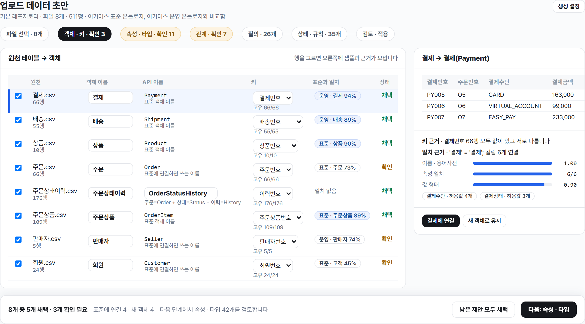
</p>

<p align="center"><b>A draft from the six files in <code>examples/files</code>, reviewed table by table.</b> Each source table is scored against the standards the draft compares with and bound to the standard object or kept as a new one, with an English name from the standards and the glossaries; the picked table shows its sample rows, why its key is a key and the match evidence. The later steps settle properties, relations, queries and rules the same way before the draft is applied.</p>

## Ask once

```json
{"match": {"o": "Order", "i": "OrderItem"},
 "edges": [["o", "hasItem", "i"]],
 "where": {"and": [{"eq": ["o.status", "DELIVERED"]},
                   {"not_exists": {"match": {"c": "Claim"}, "edges": [["i", "hasClaim", "c"]]}}]},
 "return": ["i.item_id", {"col": "o.order_id", "as": "order"}],
 "order": ["item_id"]}
```

Comparisons `eq ne lt lte gt gte`, `in` / `not_in`, `contains`, `is_null` / `not_null`, `and` / `or` / `not`,
`exists` / `not_exists`; aggregates `count count_distinct sum avg min max`; `{"from": "k", "link": "broader",
"to": "a", "hops": [1, 3]}` for a link from a type to itself; `{"optional": true}` for a left join. A link can be
written in either direction, by its name or its inverse. Named queries live in the definition with their
parameters, so a model or a person can pick one by name.

## Run anywhere

| Language | Backends (examples) | optional | exists | hops | contains | Adapter |
|---|---|---|---|---|---|---|
| SQL | PostgreSQL and SQLite natively; MySQL, Oracle, SQL Server, Snowflake, BigQuery, … through sqlglot | LEFT JOIN | EXISTS | recursive CTE | strpos · instr | `SqliteBackend`, `DbApiBackend` (qmark · format · numeric) |
| Cypher 25 | Neo4j, Memgraph, Neptune openCypher, Apache AGE | OPTIONAL MATCH | `EXISTS {}` | `*1..3` + WITH DISTINCT | CONTAINS | `Neo4jBackend`, loads by UNWIND · MERGE |
| GQL | Spanner Graph, BigQuery Graph, Fabric Graph | OPTIONAL MATCH | `EXISTS {}` | `{1,3}` + ANY | refused | `CallableBackend` around your driver |
| SPARQL 1.1 | rdflib, Fuseki, GraphDB, Stardog, Virtuoso, Oxigraph | OPTIONAL | FILTER EXISTS | path alternatives + DISTINCT | CONTAINS | `RdflibBackend`, `SparqlEndpointBackend` (Graph Store Protocol · Update) |
| SQL/PGQ | Oracle 26ai, Spanner | refused | refused | `{1,3}` | POSITION | `graph_ddl()` writes the property graph over the tables |
| Gremlin 3.8 | Gremlin Server, JanusGraph, Neptune | `optional()` | `where()` | `repeat().emit()` | TextP.containing | `GremlinBackend`, loads a projection with one list binding per script |

A backend declares its `Capabilities`; a query that needs something a backend lacks is refused before it runs,
with the reason. `tests/test_live.py` runs the same studio on live PostgreSQL, MySQL, Oracle, SQL Server, Fuseki, Neo4j and Gremlin Server when
their addresses are set (`ONTLAS_LIVE_PG`, `ONTLAS_LIVE_MYSQL`, `ONTLAS_LIVE_ORACLE`, `ONTLAS_LIVE_FUSEKI`, `ONTLAS_LIVE_NEO4J`,
`ONTLAS_LIVE_GREMLIN`), and the CI runs it against service containers (Oracle by hand). Values stay in the source: a graph backend gets a projection only when you ask for one, and
after that only the change set (`DELETE DATA` / `INSERT DATA`, or `MERGE` / `DELETE`).

The same IRIs are used by the SPARQL compiler, the projection and the R2RML export, so an R2RML-aware engine
(Ontop, Stardog, GraphDB) can answer the studio's SPARQL straight from the relational source.

## Decide, act, and stay in scope

```python
r = studio.decide("returnEligibility", "I1001")
r.outputs    # {'eligible': True, 'reason': '배송 완료 후 반품기간 7일 이내입니다'}
r.matched    # ['in-window']
r.evidence   # days_since_delivery = 4 <- order_items.delivered_at, category_returnable = True <- categories.returnable

from ontlas.actions import Actor
p = studio.actions.request("requestReturn", "I1001", {"reason": "size"}, actor=Actor("bot", "agent", ["customer_agent"]))
p.status     # 'pending': role, parameters, state transition and decision all checked
studio.actions.approve(p.id, approver=Actor("kim", "human", ["operator"]))   # only a person approves
studio.actions.audit                                                       # requested, approved, executed

studio.run("myOrders", role="customer_agent", principal={"customer_id": "C001"})   # only that customer's rows
```

Decision tables export to GoRules JDM (`decide.zen.to_jdm`) and run on the ZEN engine when `use_zen=True`;
the tests check that ZEN and the built-in engine agree on every case.

Rules stay readable as they grow. All of this is in the module file, and the 규칙 · 지표 screen shows it:

| In a module | What it does |
|---|---|
| `hit_policy: priority` | The highest rule wins, and the answer says which rules it overrode |
| `parameters` | One named value, read as `@name` by rules and expressions, and as `{@name}` inside a rule's text, so a reason says the value in force; a customer module changes it alone |
| `metrics` | A number with its formula, denominator, time basis and owner |
| `conflicts` | Two sources that disagree stay open until a person picks one, and the pick is reviewed like any change |
| transitions | A state change with a guard, side effects and `after`; an action is asked again right before it runs |
| `view` | An object defined by a query, in the source, or carried along with `inline: true` where the source cannot be written |
| `format: YYYYMMDD` | Dates kept as text read as dates |
| `period`, `current(link.prop)` | The row valid now, out of rows valid for a period |
| scoped roles | Reads and writes limited to the signed-in organisation, closed when the scope is missing |

Each decision table is also read for what it leaves open: overlaps, rules that can never apply, and inputs no rule covers.

Actions check what is given (`{type, required, min, max, values, pattern, max_length}` per parameter), and may send
an external request after the change is written, only to hosts the studio file allows (`actions: {call_hosts:
[...]}`); a failed request puts the row back. An executed action can be rolled back, if nothing has changed the row
since, and an action with a request rolls back only when it declares the request that undoes it.

```python
studio.actions.rollback(p.id, actor=Actor("kim", "human", ["operator"]))      # the values before, back in place
studio.run("customerValue", {"least": 0}, role="support_agent").rows[0]       # ('C001', '김하늘', '***-****-0101', ...)
```

A property marked `mask: partial | full` (or listed in a role's `mask`) is shown masked to every role that does not
`unmask` it, and so is a computed property built from it; filtering or ordering on a masked property is refused,
since the answer would give the value away. Queries the studio runs for itself see values in clear.

An action can also say how far it goes without a person. Inside every limit it runs at once for whoever may execute it; past one it
waits. An agent's request waits too, unless the action says `agents: true`. A limit reads a property's change (`delta`, `percent`),
a value (`max`, `min`) or a parameter, and takes a number or a named value:

```yaml
actions:
  changePrice:
    target: Sku
    parameters: {price: {type: decimal, min: 0}}
    set: {price: $price}
    approval:
      auto_within:
        - {property: price, percent: "@price_auto_percent"}
```

The request records how it stood against each limit, and the audit trail says it was approved by its limits.

Who settles a request is fixed too. A person approves or rejects it, with the right to execute it on that row, and not the one who
asked; a single visitor's own page is the one place a person plays both sides. A request that ran is rolled back, not rejected,
so the record never says rejected while the source holds the change. Each line of the audit trail names the module versions the
studio stood on, and a check that asked a decision names the rule that answered; an agent's decisions, answers and functions go
in with the same.

A role reads only the documents it lists, by name or pattern, when it has a list: an agent for customers does not find the
seller's terms in a search, an answer or the list of documents.

```yaml
roles:
  customer_agent:
    read: [Order, OrderItem]
    documents: [반품정책서, 배송안내, "쿠폰*"]   # no list: every document
```

## Rules in three layers

Every decision rule belongs to the layer of the module that wrote it, and a table checks its AXIOM rules first.

| Layer | Written by | What it means |
|---|---|---|
| AXIOM | a module of kind `axiom` | Always true: laws, arithmetic integrity. No Custom or Standard module, and no workspace edit, rewrites or removes it |
| Custom | a `customer` module or the page's workspace | A customer's rules, over the Standard ones |
| Standard | any other module | The common defaults |

A module also carries `rule_cards`: the record of each rule, whether a decision row runs it or something else carries it
out (`type`: decide, compute, transition, restore, order, display, watch). A card has a statement, what it applies to,
conditions, result, exceptions, source, owner, `status` (draft, review, approved), `legal_review` (none, pending, done)
and `implements` (`decision:returnEligibility#in-window`, `function:refundEstimate`, ...). An AXIOM card's
`check: {parameter: return_window_days, min: 7}` holds on the final values, so a module, an attach or a workspace edit
that sets the return window to 5 is refused with the card, the value, the bound and who set it. A reason may say a named
value (`반품기간 {@return_window_days}일 이내입니다`), and it reads the value in force. Each decision answer carries
`path`: per layer, how many rules, which fired or that none applied, and the module and version the answer came from
(`AXIOM 통과 › Custom vip-window 적용 › Standard 앞 규칙 우선`). The example's `commerce-law` module (법령 기준, 예시) shows all
three layers. `ontlas modules studio.yaml --check` lists the checks and `--rules` the layers and cards; the page reads
`/api/semantic`.

## Functions under a contract

A function is logic the ontology owns. It says what it takes and gives, which version runs, who owns it and what it stands on, and a
role is given it by name. The runtime is only how it is carried out.

```yaml
functions:
  refundEstimate:
    label: 예상 환불 금액
    target: OrderItem
    version: 1.0.0
    owner: 정산팀
    inputs: {fee_rate: {type: decimal, required: false, default: 0, min: 0, max: 1}}
    outputs: {amount: decimal}
    expr: "line_total * (1 - @fee_rate)"
```

| `runtime` | Carried out by |
|---|---|
| `expr` (the default) | An expression compiled into the language of the store, like a computed property |
| `decision`, `query` | A decision table or a registered query |
| `python` | A callable the deployment registered: `functions: {python: {score: package.module:callable}}` in the studio file |
| `http` | A service on the hosts the studio file allows, such as a model or a solver |

A module names a callable and brings no code, so a definition uploaded to a page cannot run anything. What comes back is held to the
declared outputs. `status` is `active`, `draft` (a person tries it out, no role runs it) or `retired`, and code outside the ontology
sees a row the way the caller's role sees it. An action can take a function as a condition.

```bash
ontlas functions examples/library/studio.yaml --run refundEstimate --key I1001 --param fee_rate=0.1
```

## Values held against the system

Rules can read right and a customer still see the wrong price. `flow.values` compares what the ontology answers with what the
transaction system recorded or answers now, case by case, and `max_value_errors` makes it a pass condition:

```yaml
flow:
  gates: {check: {max_value_errors: 0}}
  values:
    - {name: shipping, label: 배송비, query: checkoutRecords, key: order_id, truth: charged_shipping,
       answer: {decision: shippingFee, output: fee}}
    - {name: price, label: 판매가, query: checkoutRecords, key: sku_id,
       truth: {url: "https://shop.example/price/$key", method: GET, path: data.price},
       answer: {type: Sku, property: price}}
```

`truth` is a column of the case or a request to the system's API, on an allowed host. `answer` is a decision, a function or a
property. The check screen lists each case that differs, and `ontlas values examples/library/studio.yaml` exits non-zero if any does.

## Identity across systems

```yaml
identities:
  Person:
    table: person_identity
    members:
      Customer: {phone: phone, name: name}
      Seller: {phone: phone, name: name}
    rules:
      - {id: same-phone-name, match: [phone, name], normalize: {phone: digits, name: trim}}
```

`studio.resolve_identity("Person")` joins the records that share every field of a rule (after normalizing), keeps
the evidence for each join, and writes the crosswalk in one transaction: `Person` is then an ordinary object with a
link to each member type, asked for the same way on every backend.

## Changes are reviewed before they are approved

A studio file's `flow:` names the stages that run and what each must pass:

```yaml
flow:
  gates:
    bind:   {max_errors: 0}          # the definition against the database
    query:  {min_agree: 1.0}         # every registered query answers the same on every backend
    decide: {min_agreement: 0.8}     # past decisions decided again give what was decided then
    check:  {min_accuracy: 0.9, min_grounded: 1.0}   # validation questions: right, and grounded
  agreement:
    decision: returnEligibility
    query: pastReturnCases           # one row per past case, with the values it had then
    inputs: {days_since_delivery: days_after_delivery, item_status: status_then}
    expect: {eligible: approved}
```

`studio.agreement()` decides every past case again and lists the ones that differ, with the rule that fired.
A question's answer is grounded when it carries its condition (the rule that matched, or the query), its source
(the rule's `cite` or its table's, the source column of each value) and the version of the module that answered;
`studio.questions().grounded` is the share, and each ungrounded answer says what it lacks. A `quality` module brings
its own `flow: {gates}`; attached, it holds the studio to whichever of the two asks more.
A change is a new version of one module: `studio.changes.propose(module, by="kim")` tries it on a copy of the
studio (the same source, a fresh graph) and records what it adds, removes and changes, the database check, the
conformance run, the questions and the agreement; `approve(id, by="lee")` refuses a change that does not pass the
flow or that its own author approves, then saves the version to the library and swaps it in. On the page, saving a
module files a change request and shows its review; `ontlas review studio.yaml module.yaml` prints the same review.

Each review also carries a regression against the studio as it stands: the questions the change newly fails or
fixes, accuracy, grounded share and agreement before and after, and the pass conditions it stops or starts meeting.
Every approved change makes a new version of the space; `/api/versions` lists them with who asked, who decided and
when, and every module version in the library. A studio file may name project milestones for the home:

```yaml
milestones:
  - {date: 2026-11-15, label: 검증 완료, detail: 검증 질문 정답률 0.9 이상}
```

Validation questions take a `type` (definition, decision, value), `holdout: true` and a `grading` (match, keywords,
evidence, llm). A definition question needs no query or decision, only the words its answer must hold (`keywords`).
Held-out questions are reported apart from the ones a definition is tuned on (`sets: {dev, holdout}`, and per type).

## Manage objects, properties and relations

The modelling workspace (온톨로지 매니저 › 그래프 탐색, its table view 엔티티 관리) is where the definition is changed: the Entities as cards on a canvas
with their keys, properties and named relations, grouped by Object; a tree by Object (or by module) with what is wrong; and the picked
element's form, data, uses, YAML and comments, each a view of the same element. One switch away the same objects,
properties and relations stand in three columns with a form under the picked row. Every element carries a status
(초안 · 사용 중 · 폐기 예정), and a deprecated element that something still reads says so where its uses are listed. The
source's tables with their rows, keys and references are on 데이터 소스, and the questions with known answers (add,
remove, or import a YAML or JSON list) on 검증 질문.

<p align="center">
  
</p>

Every edit goes into one overlay module, `workspace` ("관리 변경"). Saved to the library, it comes back at the next start
without being listed in the studio file. What it defines it changes directly; a standard's
objects, properties and relations it extends or removes, so a standard is never edited in place, and a standard's
type and key and a property a type inherits stay where they are defined. Each edit takes out what it leaves broken
elsewhere and says what that was:

```python
from ontlas.manage import Workspace

ws = Workspace(studio.composition.modules)
ws.apply("update_property", {"object": "Customer", "name": "grade", "label": "회원 등급"})
edit = ws.apply("delete_link", {"name": "placed"})
edit.took_out    # ['action:requestReturn', 'decision:returnEligibility', 'property:Customer.order_count', ...]
ws.apply("add_question", {"id": "G1", "text": "...", "query": "nope"})    # EditError: question G1: unknown query 'nope'
studio.changes.propose(ws.module, by="kim", attach=True)                  # tried on a copy, then approved
```

`modules.settle(module, base)` does the taking out for any module: the queries, decisions, actions, questions,
links, identities, state machines and computed properties that read what the module removes, and the roles that read,
filter or mask it. What the module defines itself is left for a person to fix, so an edit that breaks its own element
is refused. On the page the edits are filed as one change request; a request the trial stops comes back with its
review (the conditions it failed and what the database check found), and the edits stay to be fixed.

Rules, named values, states, actions and roles go the same way, on forms: 규칙 › 결정표 edits a rule's conditions and outcome input by
input, and a rule from a standard is replaced over it (`rules_replace`, `rules_remove`) without touching the standard. Every edit lands in
the workspace module, is tried on a copy and is approved like any other change. A library keeps its versions: open an earlier one in the
module editor and file it, and it comes back as a new version. With `--library-write`, what is switched on stays on across a restart; if a
kept module no longer fits the source, the studio starts from its file's own list and says so.

용어사전 holds what people call each definition: preferred and English labels, synonyms and abbreviations, what each
screen calls it, hidden labels used only for matching, related, broader and narrower terms, and pairs that must not be
swapped (결제금액 ≠ 주문금액, with why). A term names its definition (`concept: property:Payment.amount`); conflicts (one
label on two definitions, a synonym that is also a pair not to swap, a definition that is not there) are reported, never
refused. A question is read in the lexicon's preferred words, and an answer names the other word of a pair when one of
them was used. A glossary comes in as one edit, as a term list or a pair table (구분, 용어 A, 용어 B, 관계, 설명, 근거, 확인
필요): `ontlas lexicon import 용어집.csv --config studio.yaml -o shop-dictionary.yaml`. Objects take an `owner` and a
`tier`, Entities and decision tables an `owner`.

## A team studio

```bash
ontlas users add users.yaml kim --name 김하람 --roles editor,approver    # the password from ONTLAS_PASSWORD, or asked
ontlas serve studio.yaml --users users.yaml --library-write --journal records/journal.jsonl --sync 60
```

With `--users`, people sign in (PBKDF2 hashes, a session cookie that is HttpOnly and SameSite=Strict, writes only
from the page itself, sign-in attempts limited) and share one studio. viewer reads and asks, editor changes data and
modules and files requests, approver approves changes and actions, admin also sets the flow. `--library-write` saves
approved versions to the library folder; `--sync` reads the source again every N seconds and sends each graph the
change set.

The source database keeps what an action wrote, but not who asked for it, who approved it or what it replaced. Add
`--journal records/journal.jsonl` and requests, approvals, change requests and the audit trail are written there one line
each, and read back when the server starts: a request still waits, a change can still be rolled back, and the trail is
whole. One process writes to one file.

## Reason, validate, exchange

| Need | Call | Result |
|---|---|---|
| Derived links | `reason.rules.run_rules(onto, projection)` | inverse, symmetric and transitive (depth-capped) links, each with the facts it came from; findings for missing required links, cardinality, exclusive links, required properties, enum values, states |
| Shape validation | `reason.shacl.to_shacl(onto)`, `validate(onto, projection)` | SHACL shapes from the definition, checked with pySHACL |
| OWL reasoning | `reason.owl_rl.materialize(onto, projection)` | owlrl closure; tested to derive exactly what the built-in rules derive |
| Standards out | `exchange.owl.to_owl(onto)`, `exchange.r2rml.to_r2rml(onto)` | OWL 2 and R2RML, with a report of what was preserved, adjusted or left out |
| Standards in | `exchange.importer.from_owl(ttl)` | a starting definition from schema.org, GS1 or any OWL/RDFS, with the same report |

## The data map

The explorer shows the same assets as folders. A folder says how many of its files are indexed as documents and how many
go into a draft; a table names the objects that read it; a document, its chunks and the objects it mentions. One search
covers names and paths, the definitions a question names, and document text by words and by meaning. A deleted file goes to
the trash with its folder, comes back where it was, and every change is in the repository's work record.

<p align="center">
  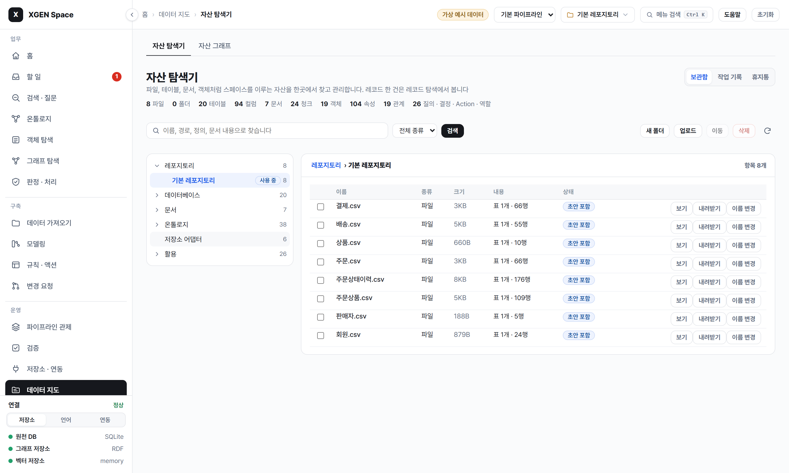
</p>

<p align="center">
  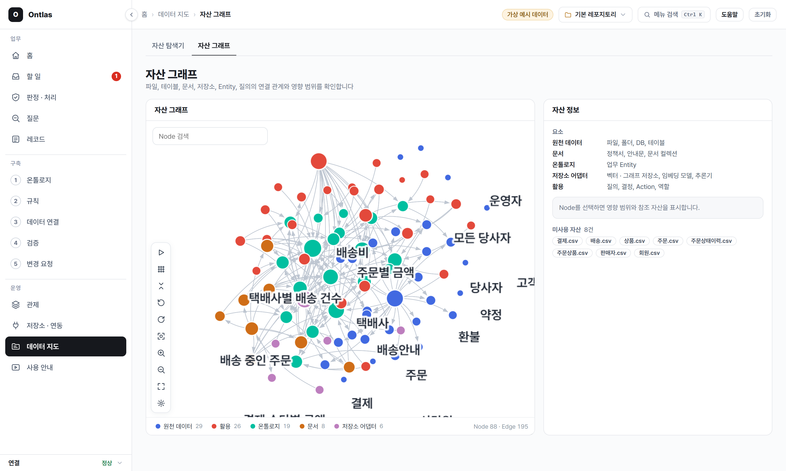
</p>

```python
from ontlas.catalog import from_ontology
cat = from_ontology(studio.onto)                  # tables, columns, objects, properties, queries, decisions, roles
cat.add_file("policies/returns.pdf", folder="policies", collection="commerce-policies")
cat.add_agent("support", roles=["customer_agent"], uses=["collection:commerce-policies"])
cat.impact("column:order_items.delivered_at")     # the property, query, decision, action, role and agent it reaches
cat.sees("support")                               # every table, column and file that agent can reach
cat.unused()                                      # what no agent or workflow uses
```

## Questions in plain language

`nl.IRGenerator(onto, llm)` gives a model a schema card (only what the role may read) and the IR format, and
takes back either an IR object or a registered query name with parameters. The answer is checked against the
ontology; if it fails, the model is asked again with the list of issues. The model never writes backend
query text. `llm` is any `(system, prompt) -> str`; `nl.openai_chat(url, model)` makes one for any
OpenAI-compatible endpoint, and `ontlas serve --llm-url ... --llm-model ...` adds a question box to the page. An answer
that checks but finds no rows goes back once with sample values of the properties it compared (only what the role
may read in clear). `ontlas nl-eval studio.yaml questions.yaml --llm-url ... --llm-model ...` scores a model on your
own questions by execution: the gold query's rows must be in the answer's;
[`examples/commerce/nl_questions.yaml`](https://github.com/PlateerLab/ontlas/blob/main/examples/commerce/nl_questions.yaml) has sixteen.

## Rules from policy text

`policy.PolicyDrafter(modules, llm).draft(text, target="OrderItem")` gives a model the same schema card, the
decision table format and the policy's clauses, and takes back one decision table. The engine checks it as a module
(inputs it can read from the target or along a path, tests it can evaluate, outputs the rules set) and checks that
every rule cites a clause the text numbers; whatever is wrong goes back to the model. The draft is a module of its
own, and a person files it as a change request, so it is tried on a copy and approved before it decides anything.
On the page, `ontlas serve --llm-url ... --policies examples/policies` adds "정책서로 규칙 초안" to the library; the
command is `ontlas policy-draft studio.yaml policy.md --target OrderItem --llm-url ... --llm-model ...`. A draft takes a
minute or more with a model that reasons first, so it runs on the server and the page collects it (up to 5 minutes).
[`examples/policies/교환정책서.md`](https://github.com/PlateerLab/ontlas/blob/main/examples/policies/교환정책서.md) is a made-up exchange policy.

## Any platform: REST and a borrowed connection

```bash
export ONTLAS_API_TOKEN=...
ontlas serve studio.yaml --api-token-env ONTLAS_API_TOKEN --api-role support_agent
curl localhost:7710/v1/search -H "Authorization: Bearer $ONTLAS_API_TOKEN" \
     -H "Content-Type: application/json" -d '{"text": "반품 기간", "k": 3}'
```

`/v1/openapi.json` describes the API for whatever imports OpenAPI, with the address it was reached at, and `/v1/tools` lists it as
function definitions; `ontlas openapi --server URL` writes the same file. `/v1/context` gives what a question is about as text for an
agent's prompt, and `/v1/function` runs a function. Search, queries in any language, translation and decisions run under the role of the token, with
its row filters and masks. It is read-only unless started with `--api-write`, and then an action is only a request a person
approves. `/v1` stays off unless a token is set. Started with `--users`, it answers from the studio the team shares: a change a
person approves holds for it at once, and an action it requests waits on the decision page for a person to approve.

Give each agent a token of its own, so the audit trail says which agent asked and one agent cannot read another's requests.
Tokens come from the environment, never from the file:

```yaml
# agents.yaml, for ontlas serve ... --api-agents agents.yaml
agents:
  - {name: 고객 응대 Agent, token_env: ONTLAS_CS_TOKEN, role: customer_agent, principal: {customer_id: C001}, write: true}
  - {name: 상담원 Agent, token_env: ONTLAS_SUPPORT_TOKEN, role: support_agent}
```

`/v1/proposals` gives a token the requests it made and how each stands, and `/v1/record` one object by its key, inside the
token's rows and masks.

The other direction: a platform that manages database connections can lend one. `kind: gateway` sends SQL as text to its query
service and reads the rows back, so the password never reaches the space and the platform's read-only rule and table allow-list
stay in force. A space reads through it and never writes. An answer that comes back full is marked as possibly cut.

```yaml
backends:
  source: {kind: gateway, url: https://platform.example/query, connection: 12, dialect: postgres, token_env: PLATFORM_TOKEN, source: true}
```

## Agents over MCP

```bash
ontlas mcp examples/commerce/studio.yaml --role customer_agent --principal customer_id=C001 [--read-only]
```

Tools: `answer_question`, `agent_context`, `find_definitions`, `list_functions`, `run_function`, `describe_object`, `describe_ontology`, `list_modules`, `list_backends`, `translate_query`, `run_query`, `run_sparql`, `run_cypher`,
`decide`, `request_action`, `list_proposals`, `get_record`. Every call runs inside the role's row filters; `request_action`
only files a request, and nothing is written until a person approves it. `list_proposals` gives an agent with a role its own
requests. `--agent NAME` is what the audit trail calls it, and `--journal FILE` keeps its requests across restarts. Works with
the MCP Python SDK 1.x and 2.x.

An agent need not read a whole ontology: `find_definitions` gives what a question is about and `describe_object` one object with what
touches it. A running server reads the library again once an approved change is saved there (`--library-write`). A request stays in its own
process, so when people approve on a team's page, have the agent call `/v1` instead.

## Install

From PyPI, or `pip install -e ".[...]"` in a checkout (the examples and tests are only in the repository):

```bash
pip install ontlas                    # core, zero deps: SQLite, JSON, the IR, every compiler, decisions, rules
pip install "ontlas[all]"             # + PyYAML, rdflib, sqlglot, pySHACL, owlrl, ZEN, MCP, openpyxl
pip install "ontlas[postgres]"        # + psycopg      ("[neo4j]" for the Neo4j driver)
pip install "ontlas[mysql]"           # + PyMySQL, sqlglot      ("[oracle]" for oracledb, "[mssql]" for SQL Server)
pip install "ontlas[pdf]"             # + pypdf, for reading PDF documents
pip install "ontlas[xlsx]"            # + openpyxl, for drafting from Excel workbooks
pip install "ontlas[gremlin]"         # + gremlinpython, for Gremlin Server
pip install "ontlas[embed]"           # + fastembed, a multilingual embedding model on this machine
pip install "ontlas[reasonable]"      # + reasonable, a fast OWL RL engine, off by default
```

Qdrant and any OpenAI-shaped embedding service need no package: they are spoken to over HTTP.

Run the demo from a checkout with only PyYAML and rdflib installed:

```bash
python examples/commerce/demo.py
```

The tests need no server. With Docker, the same tests run against real ones, one at a time:

```bash
python tools/run_live.py                  # postgres, mysql, oracle, mssql, fuseki, neo4j, gremlin, qdrant, pgvector
python tools/run_live.py pgvector qdrant  # some of them
```

## Command line

```bash
ontlas validate examples/commerce/ontology.yaml
ontlas translate examples/commerce/ontology.yaml lowStock --to sql:snowflake --param threshold=5
ontlas translate examples/commerce/ontology.yaml "MATCH (o:Order) RETURN o.status, count(o) AS n" --from cypher --to sparql
ontlas export examples/commerce/ontology.yaml --format owl         # shacl · r2rml · pgq · jdm · json · yaml · report
ontlas import-owl vocabulary.ttl -o ontology.yaml
ontlas run examples/commerce/studio.yaml myOrders --role customer_agent --principal customer_id=C001
ontlas sparql examples/commerce/studio.yaml query.rq --backend source
ontlas decide examples/commerce/studio.yaml returnEligibility I1001
ontlas questions examples/commerce/studio.yaml                    # validation questions and accuracy
ontlas conformance examples/commerce/studio.yaml                  # every registered query on every backend
ontlas preview examples/library/studio.yaml -o studio.html        # the page in the screenshots
ontlas serve examples/library/studio.yaml --port 7710             # the same page, working: one studio per visitor
ontlas serve examples/library/studio.yaml --samples examples/files  # + example files a visitor loads with one click
ontlas serve examples/library/studio.yaml --video demo.mp4          # + a demo video beside the guide (demo.chapters.json)
ontlas serve examples/library/studio.yaml --allow-connect --file-kb 4096 --rows 50000  # inside your own network only
ontlas serve examples/library/studio.yaml --repositories ./repositories --max-files 2000 --total-mb 4096  # files kept across restarts
ontlas draft examples/files/*.csv -o lib-demo                     # a definition and bindings drafted from data
ontlas ingest schema.sql 코드정의서.xlsx 용어집.xlsx 정책서.docx -o bundle.json  # anything, rolled into one JSON
ontlas draft --definitions bundle.json --name shop -o shop        # the JSON, drafted into modules
ontlas gates examples/library/studio.yaml                         # the flow's pass conditions, measured
ontlas agreement examples/library/studio.yaml                     # past decisions decided again
ontlas values examples/library/studio.yaml                        # answers held against the transaction system
ontlas functions examples/library/studio.yaml                     # registered functions; --run NAME --key K to run one
ontlas review examples/library/studio.yaml acme-1.1.0.yaml        # a new module version, reviewed on a copy
ontlas identity studio.yaml Person --write       # join the records, write the crosswalk
ontlas sync examples/library/studio.yaml --every 60               # the graphs kept up with the source
ontlas nl-eval examples/commerce/studio.yaml examples/commerce/nl_questions.yaml --llm-url ... --llm-model ...
ontlas policy-draft examples/library/studio.yaml examples/policies/교환정책서.md --target OrderItem --llm-url ... --llm-model ...
ontlas users add users.yaml kim --roles editor                    # a person of a team studio (ontlas serve --users)
ontlas search examples/library/studio.yaml "반품 기간" -k 3          # passages by meaning, and the definitions named
ontlas documents examples/library/studio.yaml                     # what the space holds: documents, stores, embedder, reasoners
ontlas vectors examples/library/studio.yaml                       # every vector store against exact search
ontlas reasoners examples/library/studio.yaml                     # what each engine derives; engines of one logic must agree
ontlas openapi --server https://space.example > openapi.json      # the REST API, for a platform to import
ontlas library list examples/library                              # every package, its kind, versions and requirements
ontlas library create my-lib energy --kind domain --label "에너지 설비" --requires core
ontlas library import-owl my-lib schema-orders.ttl schema-orders --requires core
ontlas library diff my-lib fashion 1.0.0 1.1.0                    # what a new version adds, removes, changes
ontlas library compose examples/library commerce-operations-bindings -o ontology.yaml
ontlas modules examples/library/studio.yaml --impact fashion      # what detaching it would take away
ontlas modules examples/library/studio.yaml --rules               # the rule layers and cards; --check adds the AXIOM checks
ontlas lexicon show examples/library/studio.yaml                  # the terms, what each names, conflicts
ontlas lexicon import 용어집.csv --config studio.yaml -o dictionary.yaml  # a glossary, as one module
ontlas bindings examples/library/studio.yaml                      # the definition against the database
```

A studio file names the ontology, the backends and what to project at start:

```yaml
ontology: ontology.yaml
backends:
  source: {kind: sqlite, path: commerce.db, source: true}       # postgres (dsn) · dbapi (module, connect)
  graph:  {kind: rdflib}                                         # sparql (query_url, update_url, gsp_url)
  neo:    {kind: neo4j, uri: "bolt://localhost:7687", password: "${NEO4J_PASSWORD}"}
project: [graph]
```

## Design

- **Domains are packages.** Commerce and every later domain are versioned modules in a library; a
  customer's differences and a database's bindings are modules too, so the standard is never edited to fit one site.
- **Domains meet in concepts.** Domain types hang from shared concepts and align to public vocabularies, so a
  question about a concept reaches every domain that specialises it.
- **One definition, many executions.** The definition is the only artifact people edit; SQL, Cypher, GQL,
  SPARQL, SQL/PGQ, OWL, SHACL, R2RML and JDM are all generated from it.
- **Values stay in the source.** Object types are bound to tables; a graph store is a projection you opt into,
  kept current by change sets.
- **A language model writes the IR, never the backend text.** Generated queries are checked against the
  ontology before they run, and every literal is a bound parameter.
- **Rules decide, reasoners derive.** Business decisions live in decision tables with their evidence;
  OWL RL and SHACL derive and validate facts. A decision does not depend on which reasoner is installed.
- **Prove it with the same rows.** Conformance runs compare every registered query across backends, and the
  readers are tested by compiling each query to SPARQL and Cypher and reading it back.
- **`dependencies = []`.** Everything optional is an extra; with all of them blocked the core test suite still passes.

```
src/ontlas/
  model.py validate.py      # the definition and its checks
  modules.py library.py     # packages, composition, attach / detach; the library of versioned packages
  bindings.py               # the definition against the actual database
  expr.py                   # computed properties: parse, type, render per language
  draft.py induce.py mapping.py   # drafted definitions, decision tables from outcomes, bindings onto a standard
  review.py identity.py     # flow, agreement, change requests; identities and crosswalks
  ir.py check.py values.py  # the query IR, its check, typed values
  compile/                  # sql (+ dialects) · cypher (+ gql) · sparql · pgq · gremlin
  parse/                    # sparql · cypher -> IR
  backends/                 # sql (sqlite, dbapi) · rdf (rdflib, endpoint) · graph (neo4j, callable) · gremlin
  projection.py rdf.py      # rows -> RDF / property graph, change sets; IRIs and Turtle
  decide/ actions.py roles.py
  reason/                   # rules · shacl · owl_rl
  exchange/                 # owl · r2rml · importer
  space.py embed.py vectors.py    # documents and their ontology, the embedding port, the vector store port
  rest.py                   # the token API, its OpenAPI and tool definitions
  catalog.py repository.py nl.py policy.py conformance.py studio.py config.py tools.py mcp_server.py preview.py cli.py
  web/                      # ontlas serve: api.py (answers from one studio), server.py, team.py, static/ (the page)
examples/commerce/          # one ontology file, seed data, studio file, demo
examples/library/           # the same domain as packages, plus shop operations, fashion, food and a customer overlay
examples/files/             # a fictional shop's CSV files, for drafting from data
examples/documents/         # the shop's policies and guides, for search and the document ontology
tools/                      # render_screens.py (the README images), make_commerce_seed.py (the shop), graph-kit/ (the graph engine bundle)
```

## Prior art

Ontlas is an independent project. It is not affiliated with the products below and does not copy them; these are the public
ideas it studied and what it took from each.

| Reference | What it took | Where it is here | Where it differs |
|---|---|---|---|
| [Palantir Foundry Ontology](https://www.palantir.com/docs/foundry/ontology/core-concepts) | Objects, properties and links over data sources, with actions and functions as parts of the model; language, engine and tools kept apart | `model.py`, `actions.py`, `functions.py`, the management screens | Definitions are module files anyone can read and diff; one query runs on any store rather than one backend |
| [Foundry interfaces](https://www.palantir.com/docs/foundry/interfaces/interface-overview) | One shape shared by object types, read without naming the type | `check.interface_view` | Properties keep their names across types; no property mapping and no interface extending another |
| [Microsoft Fabric IQ ontology](https://learn.microsoft.com/en-us/fabric/iq/ontology/overview) | Definitions and bindings over data left in its own system; rules beside entities; RDF and OWL in and out | Bindings, `bindings.py` check, `exchange/` | Rules run as decision tables, not as text for a model |
| [W3C Direct Mapping](https://www.w3.org/TR/rdb-direct-mapping/) and [R2RML](https://www.w3.org/TR/r2rml/) | Table to class, column to property, foreign key to link; a mapping others can read | `draft.py`, `exchange/r2rml.py` | Keys and references are also inferred from values, with the reason kept |
| [SHACL](https://www.w3.org/TR/shacl/) and [OWL 2 RL](https://www.w3.org/TR/owl2-profiles/) | Structure checks and derived facts as a layer over the store | `reason/` | Business decisions stay out of the reasoner |
| [Ontop](https://ontop-vkg.org/) and [Stardog virtual graphs](https://docs.stardog.com/virtual-graphs/) | A graph view over tables that stay where they are | `compile/`, `projection.py` | Compiles from its own query IR to six languages |
| [GoRules ZEN](https://github.com/gorules/zen) | Decision tables as data, run by an engine | `decide/`, `decide/zen.py` | A built-in evaluator gives the same answer with the grounds |
| [LinkML](https://linkml.io/) | One definition, many artifacts | `exchange/`, `ontlas export` | The definition also carries rules, actions and roles |
| [TinkerPop](https://tinkerpop.apache.org/) | A conformance suite that every provider must pass | `conformance.py`, `ontlas conformance` | Compares rows across languages, not one language across providers |
| [schema.org](https://schema.org/), [GS1 Web Vocabulary](https://ref.gs1.org/voc/), [FIBO](https://spec.edmcouncil.org/fibo/), [Brick](https://brickschema.org/) | Terms an element can align with, kept as `aligned` | `aligned`, `exchange/owl.py` | A domain stays a module, so no vocabulary is built in |
| [LightRAG](https://github.com/HKUDS/LightRAG) and [sigma.js](https://www.sigmajs.org/) | The look of the graph screen | `static/graph.js`, `static/graph-kit.js` | Clusters fold past 120 nodes for a schema of hundreds of tables |

## Roadmap

- GQL run on a real engine: its text is compiled and checked as text, and no server here executes it
- `MIN` and `MAX` over a group with a missing value on Jena and Oxigraph, which leave the whole group unbound
- TinkerPop 4 once it is released
- sign-in through an organisation's identity provider for team studios
- decision tables drawn from outcomes with dates as inputs (days between two columns)
- several source databases in one studio
- interface properties mapped to differently named properties, and interfaces that extend others

## Repository model

[`PlateerLab/ontlas`](https://github.com/PlateerLab/ontlas) is the source of truth.
Members of the PlateerLab organization commit there directly; CI runs the full suite on Python 3.10–3.12 and the
core suite with no optional dependencies.

## License

Apache License 2.0. See [LICENSE.md](https://github.com/PlateerLab/ontlas/blob/main/LICENSE.md) for details.
