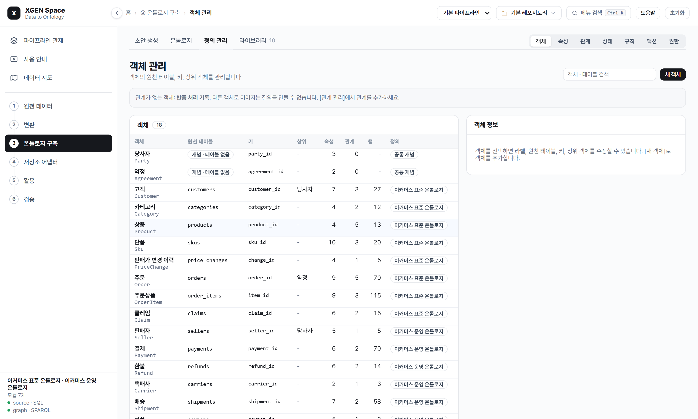

# XGEN Space

**One space for every kind of data an AI can use, tied to no store, no model, no domain and no platform.**

- **Every kind of data in one place.** Files, databases, documents, embeddings, graphs and ontologies sit in one space and know about each other.
- **Nothing is tied to a store.** Graph databases, vector databases, reasoners, embedding models and query languages are adapters, and a conformance test says whether a swap changed the answers.
- **Knowledge plugs in and out.** A domain is a versioned module. Commerce is the first one in the examples, and another domain is one more package.
- **So it fits anywhere.** MCP and a token REST API let any agent or platform use a space, and a space can read a platform's data through the connections that platform already manages.

Describe the business once (object types, properties, links, states, decisions, actions, roles) and bind it to the source
tables, or draft all of that from files. A question then becomes *one* ontology query, compiled for the store a deployment
actually has: SQL in any dialect, Cypher, ISO GQL, SPARQL, SQL/PGQ or Gremlin. Documents are cut, embedded into every vector
store the space has, and become a document ontology tied to the domain through the names both use, so a search can land on a
passage and go on to the definition. **Zero hard dependencies, zero infra to try it.**

```python
from xgen_space import Ontology
from xgen_space.studio import Studio
from xgen_space.backends.sql import SqliteBackend
from xgen_space.backends.rdf import RdflibBackend

studio = Studio(Ontology.load("examples/commerce/ontology.yaml").check())
studio.add_backend("source", SqliteBackend()).script(open("examples/commerce/seed.sql", encoding="utf-8").read())
studio.add_backend("graph", RdflibBackend())        # a graph only when you want one
studio.project()                                   # source rows -> RDF; later calls send only what changed

studio.run("revenueByCategory")                    # compiled to SQL, run on the source
studio.run("revenueByCategory", backend="graph")   # the same query as SPARQL, the same rows
studio.translate("revenueByCategory", "sql:oracle").text      # or cypher, gql, sparql, sqlpgq, sql:mysql, ...
studio.run_cypher("MATCH (o:Order)-[:hasItem]->(i:OrderItem) RETURN o.order_id, count(i) AS n")  # on SQL
studio.decide("returnEligibility", "I1001")        # outputs, the rule that fired, the columns it read
```

```bash
xspace search examples/library/studio.yaml "포장을 뜯은 속옷도 돌려보낼 수 있나요"   # passages, and the definitions the question names
xspace vectors examples/library/studio.yaml                                     # every vector store against exact search
xspace serve examples/library/studio.yaml --embedder fastembed --api-token-env XSPACE_API_TOKEN   # the page and /v1
```

<p align="center">
  
</p>

## What it is for

The space sits between the systems a business already runs and the people and agents that ask about them.

| Use | What it does |
|---|---|
| Search that goes on to the definition | Documents are searched by meaning on any vector store, each passage names the ontology elements it speaks of, and an object shows the documents that mention it |
| One shared definition | Objects, properties, relations, states, rules and roles are defined once over the source tables, in versioned module files a person can read and review |
| The same question on every store | One query compiles to SQL, Cypher, GQL, SPARQL, SQL/PGQ or Gremlin, and a conformance run compares the rows each store returns |
| Decisions with their grounds | Decision tables decide, not a language model; each answer carries the rule, the clause it cites, the source columns and the module version |
| Action under control | Roles scope rows and mask properties; an agent only files a request, nothing is written until a person approves it, and an executed action can be rolled back |
| Changes that are tried first | A new module version runs on a copy of the studio against the database check, backend agreement, validation questions and past decisions before it can be approved |
| One domain across systems and customers | A standard stays as it is; a new system gets a binding and a customer's differences get a module of their own (see [Adapt a domain](#adapt-a-domain)) |

A language model is optional. It turns plain questions into the ontology query and policy text into draft decision
tables, and the engine checks what it writes; the rest of the studio runs without one.

## What sets it apart

| Feature | How it works | Try it |
|---|---|---|
| One query, compared across stores | A query is a typed IR, not text. Compilers write each language, SPARQL and Cypher read back into the same IR, and a conformance run compares the rows store by store | `xspace conformance examples/library/studio.yaml` |
| Standards that are never edited | Every element knows the module it came from. A customer's difference extends or removes from a module of its own, and detaching a module shows what would go before anything goes | `xspace modules examples/library/studio.yaml --impact fashion` |
| Anything goes in, one JSON comes out | SQL scripts, ERD files, definition sheets, glossaries, message lists, Word, PowerPoint, Hangul and PDF documents all roll up into one JSON, and the same path makes modules from it | `xspace ingest examples/definitions/*.csv -o bundle.json` |
| A studio from what already exists | Drafts come from data, from table and code definitions with no rows, or onto a standard, and keep the reason for each choice. Composite keys and references stay whole | `xspace draft examples/files/*.csv -o my-studio` |
| Answers that show their grounds | A decision gives the rule that fired, the clause it cites and the source column of each input. A question counts as grounded only when its answer has all of them and the version, and that share can be a pass condition | `xspace decide examples/library/studio.yaml returnEligibility I1001` |
| Rules checked against what was decided | Past cases are decided again with the values they had then, and the ones that differ are listed with the rule that fired | `xspace agreement examples/library/studio.yaml` |
| Changes tried before they count | A new module version runs on a copy of the studio, and it can be approved only when it passes the flow's conditions | `xspace review examples/library/studio.yaml acme-1.1.0.yaml` |
| Edits that say what they take | Removing a property or a relation on the management screens takes out the queries, decisions and questions that need it, and lists them before anything is filed | The page's 객체 관리, 속성 관리, 관계 관리 |
| Agents inside limits | Every MCP call runs inside the role's row filters and masks. An agent files a request, and nothing is written until a person approves it | `xspace mcp examples/commerce/studio.yaml --role customer_agent --principal customer_id=C001` |
| Nothing to run first | The core has no required dependencies. SQLite and an in-process RDF graph are enough to try everything, and values stay in the source unless you ask for a projection | `python examples/commerce/demo.py` |

## How to use it

The package is not on PyPI yet, so install it from a checkout.

```bash
git clone https://github.com/PlateerLab/xgen-space.git
cd xgen-space
pip install -e ".[all]"
```

**1. See it working.** The example library is one fictional shop: a commerce standard, its operations (sellers, payments,
refunds, shipping, coupons, reviews), a fashion extension and one customer's differences.

```bash
xspace serve examples/library/studio.yaml --samples examples/files --policies examples/policies
```

Open http://127.0.0.1:7710. Each visitor gets a studio of their own, and the library folder is not written.

**2. Bring your own data.** On the page, open 데이터 카탈로그, drop files or whole folders, check 변환 결과, then make
the draft on 초안 생성 (see [The data catalog](#the-data-catalog)). From the command line:

```bash
xspace draft examples/files/*.csv --name shop --label "가상 쇼핑몰" --lang ko -o my-studio    # from files
xspace draft --definitions 테이블정의서.csv --definitions 코드정의서.csv --name shop -o my-studio   # from definitions, no rows
xspace draft --definitions schema.sql --definitions 코드정의서.xlsx --name shop -o my-studio       # from a SQL script
xspace draft --dsn "$XSPACE_DSN" --name shop -o my-studio                                     # from a database
xspace serve my-studio/studio.yaml
```

A database needs `pip install -e ".[postgres]"` (or `[mysql]`, `[oracle]`). A draft reads every table in full to
profile it, so point it at a copy or a replica with a read-only account, not at a busy production database.

**3. Check it.**

```bash
xspace bindings my-studio/studio.yaml       # the definition against the database
xspace questions my-studio/studio.yaml      # validation questions: right, and grounded
xspace conformance my-studio/studio.yaml    # every registered query on every backend
xspace gates my-studio/studio.yaml          # the flow's pass conditions, measured
```

**4. Use it.**

```bash
xspace run examples/library/studio.yaml revenueByCategory
xspace translate examples/commerce/ontology.yaml revenueByCategory --to cypher
xspace decide examples/library/studio.yaml returnEligibility I1001
```

**5. Adapt it.** Copy `examples/library/acme-overlay/1.0.0.yaml` to `acme-1.1.0.yaml`, set `version: 1.1.0`, change a
rule, and review it on a copy of the studio. See [Adapt a domain](#adapt-a-domain) for the other ways in.

```bash
xspace review examples/library/studio.yaml acme-1.1.0.yaml
```

**6. Share it.** `xspace serve --users` gives a team one studio with roles (see [A team studio](#a-team-studio)), and
`xspace mcp` gives agents the same studio inside a role (see [Agents over MCP](#agents-over-mcp)).

The page follows the data from raw files to checked answers. `Ctrl K` jumps to any screen:

| Stage | Screen | Use it to |
|---|---|---|
| 시작 | 파이프라인 관제 | See the whole pipeline as six floors, live, and where it stops when a stage fails |
| | 사용 안내 | Read what each screen does, beside the demo video when there is one |
| | 흐름 | See every stage from the source to the questions, and set the pass conditions |
| | 데이터 지도 | See how files, tables, documents, stores, objects and queries connect, and what a change reaches |
| ① 원천 데이터 | 데이터 카탈로그 | Upload files and folders into repositories, and see each file's kind, size and where it goes |
| | DB 연결 | Connect a database and draft from it, or borrow a connection a platform manages |
| ② 변환 | 변환 결과 | See what each file came to, and the one JSON they roll up into |
| | 데이터 소스 | See the source's tables, keys and references, and what reads each |
| ③ 온톨로지 구축 | 초안 생성 | Draft from the files in the catalog, step by step, and bind to a standard |
| | 객체 관리 | Change an object's table, key and parent, or add one from a table |
| | 속성 관리 | Change a property's type, column, allowed values and their names, required flag and mask |
| | 관계 관리 | Change relations and their join columns, and add the ones foreign keys suggest |
| | 온톨로지 라이브러리 | Apply and remove modules, edit a module's file, review and approve changes |
| | 온톨로지 | See objects and relations as a graph |
| | 문서 온톨로지 | See documents as documents, sections and concepts, tied to the definitions they mention |
| ④ 저장소 어댑터 | 벡터 · 임베딩 | See the embedding model, the vector stores and whether questions find their documents |
| | 어댑터 | See every swappable part, and run the tests that say a swap changed nothing |
| ⑤ 활용 | 문서 검색 | Search documents by meaning and go on to the definitions they name |
| | 질의 | Run a query, see it in each language, and ask in plain language when a model is connected |
| | 판정 · 처리 | Decide a case with its grounds, request an action, approve it, roll it back |
| | 규칙 · 지표 | See named values, metrics with their formula, sources that disagree and what a table leaves open |
| | 외부 연동 | See how MCP, REST and a platform's connection plug the space in |
| ⑥ 검증 | 검증 | Run the questions with known answers, and add, remove or import them |
| | DB 대조 | Check the definition against the database |

## What it looks like

The screens below are the studio page that `xspace preview` writes for the example library in `examples/library`
(common concepts, commerce and its operations, a fashion extension, one customer's differences, and the bindings to
one database). Nothing on them is drawn by hand: the modules, the compiled queries, the rows from both backends, the
decision with its evidence and the reach of a column change are what the library computed for that example.

`xspace serve` turns the same screens into a working page: plug modules in and out, edit any module as its file,
run a query in eight languages or write one in SPARQL or Cypher yourself, decide, file an agent's request and
approve it, run the questions and the database check. Management screens list the source's tables and the
objects, properties and relations over them, and change any of them without editing a standard (see
[Manage objects, properties and relations](#manage-objects-properties-and-relations)). A flow tab shows every stage (source, definition, database
check, projection, queries, decisions, questions) with what it holds now, the catalog keeps raw files by repository
and folder (see [The data catalog](#the-data-catalog)), 초안 생성 drafts a studio from them (see
[Start from your own data](#start-from-your-own-data)), and a guide tab explains each screen, beside a
demo video when `--video` gives one. Every visitor gets a studio of their own, built from the
same studio file, so nothing one person does reaches another; with `--users`, a team signs in and shares one studio
(see [A team studio](#a-team-studio)).

<p align="center">
  
</p>

<p align="center"><b>The ontology library.</b> Commerce and every domain added later live as separate, versioned packages;
a studio plugs in the ones it needs, and the screen shows what unplugging one would take away before it happens.</p>

<table>
  <tr>
    <td width="50%"></td>
    <td width="50%"></td>
  </tr>
  <tr>
    <td><b>Ontology.</b> A knowledge graph on WebGL: every type coloured by the module it comes from (by detected community when one module holds them all) and sized by its connections, with layouts to choose from, search, and a selected type lighting only its neighbours. Domain types hang under common concepts (customer and seller under party, order under agreement); each property shows its column and module, each type its standard alignments.</td>
    <td><b>One query, every language.</b> The ontology query, its text for PostgreSQL, MySQL, Oracle, SQL Server, Cypher 25, GQL, SPARQL, SQL/PGQ and Gremlin, and the rows from each backend side by side.</td>
  </tr>
  <tr>
    <td></td>
    <td></td>
  </tr>
  <tr>
    <td><b>Decide and act.</b> A decision table (here with the customer's own VIP rule plugged in ahead of the standard ones, each rule citing its policy), the source column behind every input, and an agent's action request waiting for a person.</td>
    <td><b>The data map.</b> What a column change touches, from property to agent; what one agent can reach; what nobody uses.</td>
  </tr>
</table>

## The pieces

| Module | What it does |
|---|---|
| `model` · `validate` | The definition: object types (key, table, properties with type, enum values and column), links (`on` a join or `via` a link table; cardinality, inverse, transitive, symmetric, required), interfaces, state machines, decision tables, actions, roles with row filters, registered queries and validation questions. JSON or YAML, checked for consistency before anything runs |
| `expr` | Computed properties: arithmetic, comparisons and functions over an object's properties, aggregates along links (`sum(hasItem.line_total)`) and the latest or earliest value of a series, typed and checked, compiled into SQL, SPARQL and Cypher (GQL and SQL/PGQ take the ones without links and dates) |
| `modules` · `library` | Domain knowledge as packages: common concepts, domains, industry extensions, one customer's differences and the bindings to a database, each versioned and kept apart in a library, composed in requirement order with the origin of every element recorded, plugged in and out at run time and swapped for an edited version; an overlay holds modules in memory over a library folder |
| `draft` · `induce` · `mapping` | Files (CSV, TSV, Excel) and databases (SQLite, PostgreSQL) read into a drafted definition and its bindings: objects, keys, types, allowed values, relations, state machines from a history table, actions, roles, questions and queries, each with its reason; a decision table drawn from past outcomes; or the tables bound onto a standard module instead of becoming new types |
| `review` | The flow's stages and pass conditions, agreement with past decisions, and change requests: a new module version tried on a copy of the studio, reviewed against the conditions, approved by another person, saved as a version |
| `identity` | Records that several systems keep under their own keys, joined by match rules into one object with a crosswalk, with the evidence for every join |
| `bindings` | The definition checked against the actual database: tables and columns, types, duplicate keys, missing required values, enum values the definition does not know, links that point at nothing |
| `ir` · `check` | The ontology query: a typed graph pattern with filters, `exists`, multi-hop links, aggregates, order and parameters. The check resolves link direction (inverse names included), types every literal and parameter, and explains what is wrong in plain sentences |
| `compile` | One compiler per language: SQL (PostgreSQL and SQLite natively, every other dialect through sqlglot), Cypher 25, ISO GQL, SPARQL 1.1, SQL/PGQ, and the `CREATE PROPERTY GRAPH` for the bound tables. Literals are always bound as parameters; NULLs sort last everywhere |
| `parse` | SPARQL and Cypher read back into the IR, so a query in either runs on any backend |
| `backends` | SQLite, any DB-API connection, rdflib, any SPARQL 1.1 endpoint, Neo4j, Gremlin Server, and a callable adapter for engines without a driver here. Each declares what it can do |
| `projection` | Source rows to RDF triples or property-graph nodes and edges, and the change set between two projections for incremental loads |
| `decide` · `actions` · `roles` | Decision tables with evidence, exported to GoRules JDM and run on ZEN; actions with checked parameter values, human approval, write-back, an external request to allowed hosts, rollback and an audit trail; role scoping of every query and tool, with masked properties |
| `reason` | Inverse, symmetric and transitive links derived with their reasons; shape checks; SHACL generated and validated; OWL 2 RL materialization |
| `exchange` | OWL and R2RML export with a report of what each format cannot hold; OWL/RDFS import as a starting definition |
| `catalog` | The data space as a graph: databases, tables, columns, files, collections, ontology objects, queries, decisions, actions, roles, agents |
| `nl` | A schema card and IR guide for a language model, and a loop that checks its answer and asks again with the issues |
| `conformance` · `studio` · `cli` · `mcp_server` · `preview` | Runs across backends compared row for row; the facade; the `xspace` command; the MCP server; the studio page as a file |
| `repository` | Repositories of raw files: folders and files by path in an index, bytes by hash, kept in a folder or gone with the visitor |
| `web` | The studio page served over HTTP with the standard library only: the pipeline board, flow with its pass conditions, the data catalog, the one JSON, the draft and standard bindings, library with the module editor and change review, ontology graph, queries, decisions, approvals and rollback, checks, and the guide with its video; one studio per visitor, or one per team behind a sign-in |

## Define once

```yaml
objects:
  OrderItem:
    label: 주문상품
    source: {table: order_items}
    key: item_id
    properties:
      delivered_at: {type: datetime, label: 배송 완료 일시}
      item_status:  {type: enum, values: [NORMAL, RETURN_REQUESTED, RETURNED]}
    states: {property: item_status, initial: NORMAL, transitions: [{from: NORMAL, to: RETURN_REQUESTED}]}
links:
  hasItem: {from: Order, to: OrderItem, cardinality: one_to_many, on: {order_id: order_id}, inverse: itemOf}
decisions:
  returnEligibility:
    target: OrderItem
    inputs:
      days_since_delivery: {type: integer, days_since: delivered_at}
      category_returnable: {type: boolean, path: [ofSku, skuOf, inCategory], property: returnable}
    outputs: {eligible: boolean, reason: string}
    rules:
      - {when: {days_since_delivery: "null"}, then: {eligible: false, reason: 배송 완료 전입니다}}
      - {when: {category_returnable: "false"}, then: {eligible: false, reason: 반품할 수 없는 카테고리입니다}}
      - {when: {days_since_delivery: "<= 7"}, then: {eligible: true, reason: 반품기간 7일 이내입니다}}
roles:
  customer_agent:
    read: [Order, OrderItem]
    row_filters:
      Order: {eq: [$self.customer_id, {principal: customer_id}]}
```

The full example is [`examples/commerce/ontology.yaml`](examples/commerce/ontology.yaml): eight object types
(one of them a price history), nine links, eight computed properties, a decision, an action, three roles, twelve
registered queries and seven validation questions.
Decision cells are a small FEEL subset: `-`, `null`, `not null`, `<= 7`, `[1..7]`, `"VIP"`, `!= "NORMAL"`,
`in ["A", "B"]`, `true`.

## Computed properties and series

```yaml
OrderItem:
  properties:
    line_total: {type: decimal, expr: "unit_price * quantity"}
Order:
  properties:
    total:  {type: decimal, expr: "coalesce(sum(hasItem.line_total), 0)"}
    billed: {type: decimal, expr: "if(status = 'CANCELLED', 0, total)"}
PriceChange:
  series: {time: changed_at, of: priceOf}        # observations over time
Sku:
  properties:
    last_price: {type: decimal, expr: "latest(priceChanges.price)"}
```

A computed property is asked for like any other (`o.total`, in IR, SPARQL or Cypher) and compiled into each
language: a scalar subquery in SQL, `BIND` and a grouped subquery in SPARQL, a pattern comprehension in Cypher. It is
never copied into a graph, so the conformance run compares the expression itself across backends. Nulls follow one
rule everywhere (division by zero and an `if` on a null condition give null). Functions: `coalesce`, `if`, `abs`,
`round`, `floor`, `ceil`, `lower`, `upper`, `length`, `concat`, `year`, `month`, `day`, `days_between`; aggregates
along a link path: `sum`, `avg`, `min`, `max`, `count`, and `latest` / `earliest` on a series. A language that has no
form for one says so before it runs.

## Swap anything: the ports

Every part a deployment might want different is a port with a small interface, a registry, and a test that says the swap
changed nothing.

| Port | In the package | Add your own | The test |
|---|---|---|---|
| Query backends | SQLite, PostgreSQL, MySQL, Oracle, SQL Server, any DB-API, rdflib, SPARQL endpoints, Neo4j, Gremlin, a query gateway | `kind: dbapi`, or a `Backend` | `xspace conformance`: the same rows on every store |
| Vector stores | memory (exact), Qdrant, pgvector | `register_vector_store` | `xspace vectors`: every store against exact search |
| Embedders | hash (no model), any OpenAI-shaped service, fastembed (a local multilingual model) | `register_embedder` | Search checks in `space.checks`, a pass condition of the flow |
| Reasoners | rules, owlrl, shacl, reasonable, any HTTP service that takes and returns turtle | `register_reasoner` | `xspace reasoners`: engines of one logic must derive the same facts |
| Domains | modules in a library | a package | Validation questions and the flow's conditions |

Two OWL 2 RL engines run side by side is how `reasonable` 0.4.4 was found to join every subject of an inverse functional
property with `sameAs`. It stays available and off the default list. That is what the comparison is for.

```yaml
space:
  embedder: {kind: openai, url: https://models.example/v1, model: bge-m3, key_env: EMBED_KEY}
  vectors:
    main: {kind: qdrant, url: http://localhost:6333}
    pg:   {kind: pgvector, dsn: "${XSPACE_PG}"}      # every store holds the same chunks
  documents: ["docs/*.md", "policies/*.pdf"]
  checks:
    - {text: 택배가 일주일째 안 와요, document: 배송안내}   # the flow's index stage: found in the top five?
reasoners:
  rl: {kind: owlrl}
  theirs: {kind: http, url: https://reasoner.example/infer}
```

## Documents in the space

A document that comes in, through the catalog or `space.documents`, goes two ways at once.

- **Vectors.** It is cut at sections and sentences, embedded, and written to every vector store. Only what changed is embedded; a store that missed a round catches up on the next one.
- **Document ontology.** It becomes rows of document, section and concept. Concepts are the names the definitions give (objects, properties, allowed values, decisions, glossary terms) plus the words a document keeps returning to, found without a model. The rows run on the same engine as the domain ontology, so the same compilers and the same conformance apply.

Concepts tie the two together. `xspace search` returns the passages and the definitions a question names, the object screen
shows the sections that mention an object, and the map shows which queries a document touches. Relations between concepts are
co-mentions, not extracted meaning: they say two things appear together.

## Plug domains in and out

Domain knowledge comes and goes, so it is packaged. A library keeps each package apart as
`<name>/<version>.yaml`; a studio composes the ones it needs.

| Kind | Example | What it holds |
|---|---|---|
| `core` | `core` (공통 개념) | Concepts every domain hangs from: party, agreement, the `Named` interface |
| `domain` | `commerce`, `commerce-operations` | The standard definition of a domain, aligned to schema.org or GS1, with no tables in it |
| `industry` | `fashion`, `food` | What one industry adds on top of the standard: material and season, expiry and storage |
| `customer` | `acme-overlay` | Only what one customer does differently: an extra property, a VIP rule placed ahead of the standard ones, a query taken out |
| `binding` | `commerce-bindings` | The tables and columns of one database. Swap it, and the same definition reads another system |
| `quality` | `return-quality` | How a definition is checked: validation questions and the flow's pass conditions. Attached, it raises the studio's conditions where it asks more; detached, they go back |
| `method` | `build-rules` | How a draft is built from data: the draft rules (allowed-value limits, key, state and person hints) the data tab starts from |
| `dictionary` | a drafted `shop-dictionary` | A system's words and messages: a glossary finds the standard's names and reaches the language model's schema card, and a decision that answers with a message code shows the message |

```yaml
module: acme-overlay
kind: customer
requires: [commerce, commerce-bindings]
extend:
  objects:
    OrderItem: {properties: {gift_wrap: {type: boolean, label: 선물 포장}}}
  decisions:
    returnEligibility:
      inputs: {customer_grade: {type: string, path: [itemOf, placedBy], property: grade}}
      rules_prepend:
        - {id: vip-window, when: {customer_grade: '"VIP"', days_since_delivery: "<= 14"},
           then: {eligible: true, reason: VIP 고객은 14일까지 반품할 수 있습니다}, cite: ACME 운영 정책 4.1}
remove: {queries: [wishlistCount]}
```

```python
from xgen_space.library import Library
lib = Library("examples/library")
studio = Studio.from_library(lib, ["commerce-operations-bindings", "fashion", "acme-overlay"])  # + requirements
db = studio.add_backend("source", SqliteBackend())
for seed in ("examples/commerce/seed.sql", "examples/library/seed_operations.sql"):
    db.script(open(seed, encoding="utf-8").read())

studio.composition.owner("property:OrderItem.gift_wrap")     # 'acme-overlay': every element knows its module
studio.detach_impact("fashion").removed                      # what would go, before anything goes
studio.detach("acme-overlay"); studio.attach("acme-overlay") # the VIP rule leaves and comes back
studio.detach("commerce")                                    # refused: three modules depend on it (cascade=True to take them too)
studio.run("allParties")                                     # one concept, two types: customers and sellers
studio.check_bindings()                                      # the definition against the actual database
```

A concept with no table of its own is asked through its subtypes: in SQL as the `UNION ALL` of their tables,
in SPARQL and Cypher through the concept's type or label, and the conformance run checks the answers agree.
`aligned` IRIs export as `skos:exactMatch`, `cite` as `dcterms:source`, the module as `rdfs:isDefinedBy`; an
imported standard keeps its original IRIs as alignments.

## Adapt a domain

Adapting a domain to a system means leaving its standard as it is and writing only what differs. Whatever you start
from, the result is the same kind of file, a module, so it is checked, reviewed, versioned, attached and detached like
the rest.

| You have | Path | It becomes |
|---|---|---|
| A standard that fits, and the system's tables | `mapping.suggest`, the page's "표준에 연결" | A `binding` module |
| Table and code definitions, a SQL script, an ERD file | `xspace draft --definitions` | A definition and its `binding`, with no rows needed |
| A code definition whose codes refer to other codes | The same draft | Decision tables: what each code implies, or what each state allows |
| A glossary, a message list | The same draft | A `dictionary` module |
| Data files or a database | `xspace draft` | A definition and its `binding` |
| Past outcomes | `induce`, the rules step of a draft | A decision table |
| Policy text, in any document format | `xspace policy-draft`, the library's "정책서로 규칙 초안" | A module with a decision table, each rule citing its clause |
| An OWL or RDFS ontology | `xspace import-owl` | A starting definition |
| Edits on the management screens | Objects, properties, relations, questions | The `workspace` module, of kind `customer` |
| Knowledge of the domain | A YAML file, or the library's module editor | A module of any kind |

A definition drafted from one system describes that system. To carry a domain across systems, bind the tables to a
standard instead: its queries, decisions and questions carry over, less what the tables do not hold. Matching goes by
names, labels and types, and a glossary says which of the system's words mean what the standard names (회원 is 고객).
A system that abbreviates its names still gets partial suggestions, and a person picks the rest: choosing another
table matches its columns and relations again.

A studio reads one source database today. A draft from definitions alone is checked against an empty database of
the same shape, which says nothing about real rows: for that, get read-only access to a development database.

### Anything in, one JSON

`xspace ingest` reads each file through an adapter and rolls everything into one JSON, which `xspace draft --definitions`
takes like any other input. On the page, the same adapters read what reaches the catalog, and 변환 결과 shows the JSON.

| Input | Read as |
|---|---|
| `.sql`, `.ddl` (PostgreSQL, MySQL, Oracle, SQL Server, SQLite) | Tables, keys, references, comments as names, `ENUM` and `CHECK ... IN` as allowed values |
| `.dbml`, `.pdm` (PowerDesigner), `.mwb` (MySQL Workbench) | The same, from the modelling tool's own file |
| `.db`, `.sqlite` | The tables, keys and references of a SQLite file |
| `.csv`, `.xlsx`: table, index, code, glossary and message sheets | By their headers, Korean or English, under a title and behind a cover sheet. Group rows and reference columns of a code definition are understood |
| `.docx`, `.pptx`, `.hwp`, `.hwpx`, `.pdf`, `.html`, `.md`, `.txt` | Text by section, for policy drafting (`.pdf` needs `[pdf]`). A `.hwp` with a password or a viewing-only copy is refused |
| `.json` | The same shape, written by hand or by another tool |

```json
{"tables": [{"name": "TB_ORDER", "label": "주문", "primary_key": ["ORDER_NO"],
             "columns": [{"name": "ORDER_NO", "label": "주문번호", "type": "varchar"}, {"name": "STAT_CD", "code": "OD01"}],
             "references": [{"columns": ["MEMBER_NO"], "table": "TB_MEMBER", "ref_columns": ["MEMBER_NO"]}]}],
 "codes": {"OD01": {"label": "주문상태", "values": [{"code": "10", "name": "주문접수"}]}},
 "terms": [{"term": "고객", "synonyms": ["회원"]}],
 "messages": [{"code": "MSG-RT-001", "text": "반품 가능 기간이 지났습니다."}],
 "documents": [{"name": "교환정책서", "kind": "policy", "text": "...", "sections": [{"title": "1. 반품 기간", "text": "..."}]}]}
```

A format with no adapter here goes through a plug-in: a Python file that calls `ingest.register([".ext"], fn)` and
returns `Definitions`, loaded with `xspace ingest --adapter FILE` or `XSPACE_ADAPTERS`. A binary format nothing reads is
refused with what to export it to.

## The pipeline board

파이프라인 관제 is the page's first screen. It draws the pipeline as a building: raw data at the bottom, then conversion,
the ontology, the storage adapters, its use, and verification at the top, with the data climbing one belt through the floors.

<p align="center">
  
</p>

Nothing on it is scripted. Every number comes from the space as it is now, so it works on any ontology, including a
draft from your own files: tables and rows, files by kind, modules, objects and relations, query results compared across
backends, decision agreement, question accuracy, pass conditions. Numbers refresh every 2 seconds. The flow is measured
again as soon as the definition or the files change, and otherwise every 20 seconds while the board is open.

A stage that misses its pass conditions stops the data at its floor, and a failure that crosses floors is told as a chain
from where it shows down to the module that brought it:

```text
질의 ← DB 대조 ← 식품 업종 확장 모듈   (Sku.expires_on, Sku.storage)
```

To see that on the example library, choose 장애 테스트: it really applies a module whose columns the database does not have,
and 복구 takes it off again. A studio file names such modules itself:

```yaml
monitor:
  faults:
    - {label: 식품 업종 모듈 적용, attach: food}
```

Each draft you apply becomes a pipeline of its own. The list at the top of the page switches between them, the one you
started with included, and 초기화 is no longer the only way back. A visitor keeps up to five.

## The data catalog

Raw material comes first. 데이터 카탈로그 keeps files in repositories, by folder, and says what each one turned out to be.

<p align="center">
  
</p>

| You do | It does |
|---|---|
| Drop files or a whole folder | Uploads into the current folder and keeps the folder's structure. `.DS_Store`, `Thumbs.db` and Mac archive metadata stay out |
| Upload something it cannot read | Keeps the file and says why on its row. Images, video and archives are kept as they are, so a repository can hold everything a project has |
| Look at a row | Kind, size, rows or sections, and where it goes: a table or a definition sheet to the domain and binding modules, a code sheet to value names and decision tables, a glossary to the term dictionary, a document to the policy draft |
| Open a file | First rows or sections, its share of the JSON, and a download |
| Clear a file's or folder's 초안 box | Leaves it out of 변환 결과 and of the next draft, and keeps it in the catalog |
| Switch repository | The draft reads that repository's files from then on |

A path in a repository is a name in an index, never a path on disk: the bytes are stored under their SHA-256, so nothing
a visitor types reaches the file system, and two copies of a file cost one.

Without `--repositories` the files go with the visitor's session, which suits a public demo. With it they stay in that
folder across restarts, one set for all visitors. `--file-kb`, `--max-files` and `--total-mb` set the limits, and
`--allow-connect` adds 경로 입력, which brings in a file or folder from the server's own disk.

```bash
xspace serve studio.yaml --repositories ./repositories --file-kb 51200 --max-files 2000 --total-mb 4096 --allow-connect
```

## Start from your own data

A definition does not have to be written first. `xspace draft` reads files or a database and drafts the two
modules a library expects, a definition and its bindings, keeping the reason for every choice:

| | How it is decided |
|---|---|
| Objects | One per table, after the W3C Direct Mapping; a table of two relation columns and nothing else becomes a many-to-many link instead |
| Keys | The declared primary key; for files, a column whose values are all present and distinct (a row number when none is) |
| Types | A database's declared types (ISO text in SQLite is read as dates); for files, the values: integers with or without thousands separators, decimals, dates, date-times, booleans. Values with leading zeros stay text, as codes |
| Allowed values | Text columns whose few values repeat |
| Relations | Declared foreign keys; otherwise a column named after another table's key (the same name, `<table>_<key>`, `<table>_id`) whose values are all found among that key's values. A key name many tables share, such as `id`, does not make a relation by its name alone |
| States | A status column (by the state name hints) with allowed values; a table that keeps past states of the same rows gives the transitions in the order they happened and the usual first state, and becomes a series. One action per state things move into |
| Roles | A viewer, an operator when there are actions, and for a person-like table (by the person name hints) a role that reads only one person's rows |
| Queries | A list per object, a count per relation and per allowed value, so a conformance run has something to compare from the start |
| Questions | Each generated query with the rows it gives now, to check later changes against |

```bash
xspace draft members.csv products.csv orders.csv -o shop-demo   # shop-demo/library/, data.sqlite, studio.yaml
xspace draft --sqlite shop.db --name shop                     # opened read-only; prints the two modules
xspace draft --dsn "$XSPACE_DSN" -o shop                         # the studio file reads ${XSPACE_DSN}, not the password
xspace draft *.csv --rules '{"enum_max": 10, "infer_links": false}' --drop object:Log -o shop-demo
xspace serve shop-demo/studio.yaml
```

Nothing in the draft is fixed. The rules above are `DraftRules` (how many distinct values still make a category,
whether relations are inferred, whether link tables become many-to-many links, the name hints for titles, parents
and keys, which queries to generate), and `Draft.revise()` takes a person's edits on top: another key column, a
property's type and allowed values, labels, left-out objects, properties and queries, a relation's cardinality, a
relation added by hand. A type chosen for a file's column is how its values are loaded, and a value that does not
fit is reported with its table, column and value.

On the example commerce database (primary keys declared, foreign keys not) the draft finds the eight relations of
the hand-written commerce ontology, the wishlist table as a many-to-many link included, and every generated query
returns the same rows from SQLite and from the RDF projection. On the page, 초안 생성 does the same for the files in
the catalog (and, with `--allow-connect`, 'DB 연결' for a database address): the draft builds step by step with
the reason for each object, key, type and relation, a person sets the rules and edits each step (every edit is
checked again on the spot, and errors hold the draft back), and the draft is plugged into that visitor's studio.
Any module, the example ones and a plugged-in draft alike, opens on the library tab as its file: edit its objects,
decisions, questions or roles, check it, and save it into that visitor's library; a plugged-in module is swapped
in at once (`Studio.replace`). The library folder itself is not written; download the file to keep it.
`examples/files` holds a fictional library's files to try it with.

Table and code definitions, the way projects keep them, name what the draft finds and give coded columns their
allowed values with their names: a table definition sheet (a row per column: table, column, their names, type, key,
code group, referenced table) and a code definition sheet (a row per code: group, code, name, in use), as CSV or
Excel with the usual Korean or English headers, or as JSON (`definitions.Definitions`). A column whose name says
its group, `주문상태(OD01)`, needs no group column. With definitions alone the draft reads the schema: an empty
database with the declared keys and references, so objects, keys, relations, allowed values and state lists
come before any row does.

A table keyed by several columns gets one key property that reads them all (`columns: [ORDER_NO, ITEM_SEQ]`). It is
one value to everything above the columns (`O1|2` to a decision, a request or a graph node), and SQL joins it column
by column. A standard's key can read several columns the same way, in a binding:
`columns: {item_id: [ORDER_NO, ITEM_SEQ]}`.

```bash
xspace draft --definitions 테이블정의서.csv --definitions 코드정의서.csv --tables 'TB_*' -o shop   # the schema alone
xspace draft --sqlite shop.db --definitions 코드정의서.xlsx                                       # names and codes for data
```

An allowed value carries its name in the definition itself: `values: {"10": 주문접수, "20": 결제완료}`, or `values`
with `labels`; an extension adds names to the ones given (`values_add: {"30": 배송중}`). On the page the data tab
takes the same files beside the data (`examples/definitions` holds a fictional pair), and the properties screen
edits a value and its name as `10=주문접수`.

Two more ways to start. A decision table drawn from past outcomes (`induce.induce`, the page's rules step): a person
picks the column that holds what was decided and the inputs, of the same table or one relation away; each leaf of a
shallow decision tree becomes a rule with how many past cases it covers and gets right, and a five-fold
cross-validation says how well it decides cases it was not drawn from. And bindings onto a standard instead of new
types (`mapping.suggest`, the page's "표준에 연결"): every table and column is scored against the standard's types
and properties (names, labels, aligned vocabulary, romanized Korean, types, allowed values, keys), relations come from
the draft's, and the confirmed matches become a binding module; what the tables do not carry is left out, with the
queries that need it. On the example commerce database it gives the bindings a person wrote, inherited properties
included.

<p align="center">
  
</p>

<p align="center"><b>A draft from the six files in <code>examples/files</code>.</b> Each step shows what it found; here the relations, each with the
values that matched and an editable name and cardinality, and the definition check that clears the draft to be plugged in.</p>

## Ask once

```json
{"match": {"o": "Order", "i": "OrderItem"},
 "edges": [["o", "hasItem", "i"]],
 "where": {"and": [{"eq": ["o.status", "DELIVERED"]},
                   {"not_exists": {"match": {"c": "Claim"}, "edges": [["i", "hasClaim", "c"]]}}]},
 "return": ["i.item_id", {"col": "o.order_id", "as": "order"}],
 "order": ["item_id"]}
```

Comparisons `eq ne lt lte gt gte`, `in` / `not_in`, `contains`, `is_null` / `not_null`, `and` / `or` / `not`,
`exists` / `not_exists`; aggregates `count count_distinct sum avg min max`; `{"from": "k", "link": "broader",
"to": "a", "hops": [1, 3]}` for a link from a type to itself; `{"optional": true}` for a left join. A link can be
written in either direction, by its name or its inverse. Named queries live in the definition with their
parameters, so a model or a person can pick one by name.

## Run anywhere

| Language | Backends (examples) | optional | exists | hops | contains | Adapter |
|---|---|---|---|---|---|---|
| SQL | PostgreSQL and SQLite natively; MySQL, Oracle, SQL Server, Snowflake, BigQuery, … through sqlglot | LEFT JOIN | EXISTS | recursive CTE | strpos · instr | `SqliteBackend`, `DbApiBackend` (qmark · format · numeric) |
| Cypher 25 | Neo4j, Memgraph, Neptune openCypher, Apache AGE | OPTIONAL MATCH | `EXISTS {}` | `*1..3` + WITH DISTINCT | CONTAINS | `Neo4jBackend`, loads by UNWIND · MERGE |
| GQL | Spanner Graph, BigQuery Graph, Fabric Graph | OPTIONAL MATCH | `EXISTS {}` | `{1,3}` + ANY | refused | `CallableBackend` around your driver |
| SPARQL 1.1 | rdflib, Fuseki, GraphDB, Stardog, Virtuoso, Oxigraph | OPTIONAL | FILTER EXISTS | path alternatives + DISTINCT | CONTAINS | `RdflibBackend`, `SparqlEndpointBackend` (Graph Store Protocol · Update) |
| SQL/PGQ | Oracle 26ai, Spanner | refused | refused | `{1,3}` | POSITION | `graph_ddl()` writes the property graph over the tables |
| Gremlin 3.8 | Gremlin Server, JanusGraph, Neptune | `optional()` | `where()` | `repeat().emit()` | TextP.containing | `GremlinBackend`, loads a projection with one list binding per script |

A backend declares its `Capabilities`; a query that needs something a backend lacks is refused before it runs,
with the reason. `tests/test_live.py` runs the same studio on live PostgreSQL, MySQL, Oracle, SQL Server, Fuseki, Neo4j and Gremlin Server when
their addresses are set (`XSPACE_LIVE_PG`, `XSPACE_LIVE_MYSQL`, `XSPACE_LIVE_ORACLE`, `XSPACE_LIVE_FUSEKI`, `XSPACE_LIVE_NEO4J`,
`XSPACE_LIVE_GREMLIN`), and the CI runs it against service containers (Oracle by hand). Values stay in the source: a graph backend gets a projection only when you ask for one, and
after that only the change set (`DELETE DATA` / `INSERT DATA`, or `MERGE` / `DELETE`).

The same IRIs are used by the SPARQL compiler, the projection and the R2RML export, so an R2RML-aware engine
(Ontop, Stardog, GraphDB) can answer the studio's SPARQL straight from the relational source.

## Decide, act, and stay in scope

```python
r = studio.decide("returnEligibility", "I1001")
r.outputs    # {'eligible': True, 'reason': '배송 완료 후 반품기간 7일 이내입니다'}
r.matched    # ['in-window']
r.evidence   # days_since_delivery = 4 <- order_items.delivered_at, category_returnable = True <- categories.returnable

from xgen_space.actions import Actor
p = studio.actions.request("requestReturn", "I1001", {"reason": "size"}, actor=Actor("bot", "agent", ["customer_agent"]))
p.status     # 'pending': role, parameters, state transition and decision all checked
studio.actions.approve(p.id, approver=Actor("kim", "human", ["operator"]))   # only a person approves
studio.actions.audit                                                       # requested, approved, executed

studio.run("myOrders", role="customer_agent", principal={"customer_id": "C001"})   # only that customer's rows
```

Decision tables export to GoRules JDM (`decide.zen.to_jdm`) and run on the ZEN engine when `use_zen=True`;
the tests check that ZEN and the built-in engine agree on every case.

Actions check what is given (`{type, required, min, max, values, pattern, max_length}` per parameter), and may send
an external request after the change is written, only to hosts the studio file allows (`actions: {call_hosts:
[...]}`); a failed request puts the row back. An executed action can be rolled back, if nothing has changed the row
since, and an action with a request rolls back only when it declares the request that undoes it.

```python
studio.actions.rollback(p.id, actor=Actor("kim", "human", ["operator"]))      # the values before, back in place
studio.run("customerValue", {"least": 0}, role="support_agent").rows[0]       # ('C001', '김하늘', '***-****-0101', ...)
```

A property marked `mask: partial | full` (or listed in a role's `mask`) is shown masked to every role that does not
`unmask` it, and so is a computed property built from it; filtering or ordering on a masked property is refused,
since the answer would give the value away. Queries the studio runs for itself see values in clear.

## Identity across systems

```yaml
identities:
  Person:
    table: person_identity
    members:
      Customer: {phone: phone, name: name}
      Seller: {phone: phone, name: name}
    rules:
      - {id: same-phone-name, match: [phone, name], normalize: {phone: digits, name: trim}}
```

`studio.resolve_identity("Person")` joins the records that share every field of a rule (after normalizing), keeps
the evidence for each join, and writes the crosswalk in one transaction: `Person` is then an ordinary object with a
link to each member type, asked for the same way on every backend.

## Changes are reviewed before they are approved

A studio file's `flow:` names the stages that run and what each must pass:

```yaml
flow:
  gates:
    bind:   {max_errors: 0}          # the definition against the database
    query:  {min_agree: 1.0}         # every registered query answers the same on every backend
    decide: {min_agreement: 0.8}     # past decisions decided again give what was decided then
    check:  {min_accuracy: 0.9, min_grounded: 1.0}   # validation questions: right, and grounded
  agreement:
    decision: returnEligibility
    query: pastReturnCases           # one row per past case, with the values it had then
    inputs: {days_since_delivery: days_after_delivery, item_status: status_then}
    expect: {eligible: approved}
```

`studio.agreement()` decides every past case again and lists the ones that differ, with the rule that fired.
A question's answer is grounded when it carries its condition (the rule that matched, or the query), its source
(the rule's `cite` or its table's, the source column of each value) and the version of the module that answered;
`studio.questions().grounded` is the share, and each ungrounded answer says what it lacks. A `quality` module brings
its own `flow: {gates}`; attached, it holds the studio to whichever of the two asks more.
A change is a new version of one module: `studio.changes.propose(module, by="kim")` tries it on a copy of the
studio (the same source, a fresh graph) and records what it adds, removes and changes, the database check, the
conformance run, the questions and the agreement; `approve(id, by="lee")` refuses a change that does not pass the
flow or that its own author approves, then saves the version to the library and swaps it in. On the page, saving a
module files a change request and shows its review; `xspace review studio.yaml module.yaml` prints the same review.

## Manage objects, properties and relations

The page's data management screens come before the library: the source's tables with their rows, keys and
references and the objects and relations that read each one; the objects with their tables, keys and parents; every
property with its type, column, allowed values, unit, required flag and mask; the relations with the columns they
join on, with the ones the source's foreign keys suggest; and, on the checks screen, the questions with known
answers (add, remove, or import a YAML or JSON list).

<p align="center">
  
</p>

Every edit goes into one overlay module, `workspace` ("관리 변경"). What it defines it changes directly; a standard's
objects, properties and relations it extends or removes, so a standard is never edited in place, and a standard's
type and key and a property a type inherits stay where they are defined. Each edit takes out what it leaves broken
elsewhere and says what that was:

```python
from xgen_space.manage import Workspace

ws = Workspace(studio.composition.modules)
ws.apply("update_property", {"object": "Customer", "name": "grade", "label": "회원 등급"})
edit = ws.apply("delete_link", {"name": "placed"})
edit.took_out    # ['action:requestReturn', 'decision:returnEligibility', 'property:Customer.order_count', ...]
ws.apply("add_question", {"id": "G1", "text": "...", "query": "nope"})    # EditError: question G1: unknown query 'nope'
studio.changes.propose(ws.module, by="kim", attach=True)                  # tried on a copy, then approved
```

`modules.settle(module, base)` does the taking out for any module: the queries, decisions, actions, questions,
links, identities, state machines and computed properties that read what the module removes, and the roles that read,
filter or mask it. What the module defines itself is left for a person to fix, so an edit that breaks its own element
is refused. On the page the edits are filed as one change request; a request the trial stops comes back with its
review (the conditions it failed and what the database check found), and the edits stay to be fixed.

## A team studio

```bash
xspace users add users.yaml kim --name 김하람 --roles editor,approver    # the password from XSPACE_PASSWORD, or asked
xspace serve studio.yaml --users users.yaml --library-write --sync 60
```

With `--users`, people sign in (PBKDF2 hashes, a session cookie that is HttpOnly and SameSite=Strict, writes only
from the page itself, sign-in attempts limited) and share one studio. viewer reads and asks, editor changes data and
modules and files requests, approver approves changes and actions, admin also sets the flow. `--library-write` saves
approved versions to the library folder; `--sync` reads the source again every N seconds and sends each graph the
change set.

## Reason, validate, exchange

| Need | Call | Result |
|---|---|---|
| Derived links | `reason.rules.run_rules(onto, projection)` | inverse, symmetric and transitive (depth-capped) links, each with the facts it came from; findings for missing required links, cardinality, exclusive links, required properties, enum values, states |
| Shape validation | `reason.shacl.to_shacl(onto)`, `validate(onto, projection)` | SHACL shapes from the definition, checked with pySHACL |
| OWL reasoning | `reason.owl_rl.materialize(onto, projection)` | owlrl closure; tested to derive exactly what the built-in rules derive |
| Standards out | `exchange.owl.to_owl(onto)`, `exchange.r2rml.to_r2rml(onto)` | OWL 2 and R2RML, with a report of what was preserved, adjusted or left out |
| Standards in | `exchange.importer.from_owl(ttl)` | a starting definition from schema.org, GS1 or any OWL/RDFS, with the same report |

## The data map

```python
from xgen_space.catalog import from_ontology
cat = from_ontology(studio.onto)                  # tables, columns, objects, properties, queries, decisions, roles
cat.add_file("policies/returns.pdf", folder="policies", collection="commerce-policies")
cat.add_agent("support", roles=["customer_agent"], uses=["collection:commerce-policies"])
cat.impact("column:order_items.delivered_at")     # the property, query, decision, action, role and agent it reaches
cat.sees("support")                               # every table, column and file that agent can reach
cat.unused()                                      # what no agent or workflow uses
```

## Questions in plain language

`nl.IRGenerator(onto, llm)` gives a model a schema card (only what the role may read) and the IR format, and
takes back either an IR object or a registered query name with parameters. The answer is checked against the
ontology; if it fails, the model is asked again with the list of issues. The model never writes backend
query text. `llm` is any `(system, prompt) -> str`; `nl.openai_chat(url, model)` makes one for any
OpenAI-compatible endpoint, and `xspace serve --llm-url ... --llm-model ...` adds a question box to the page. An answer
that checks but finds no rows goes back once with sample values of the properties it compared (only what the role
may read in clear). `xspace nl-eval studio.yaml questions.yaml --llm-url ... --llm-model ...` scores a model on your
own questions by execution: the gold query's rows must be in the answer's;
[`examples/commerce/nl_questions.yaml`](examples/commerce/nl_questions.yaml) has sixteen.

## Rules from policy text

`policy.PolicyDrafter(modules, llm).draft(text, target="OrderItem")` gives a model the same schema card, the
decision table format and the policy's clauses, and takes back one decision table. The engine checks it as a module
(inputs it can read from the target or along a path, tests it can evaluate, outputs the rules set) and checks that
every rule cites a clause the text numbers; whatever is wrong goes back to the model. The draft is a module of its
own, and a person files it as a change request, so it is tried on a copy and approved before it decides anything.
On the page, `xspace serve --llm-url ... --policies examples/policies` adds "정책서로 규칙 초안" to the library; the
command is `xspace policy-draft studio.yaml policy.md --target OrderItem --llm-url ... --llm-model ...`. A draft takes a
minute or more with a model that reasons first, so it runs on the server and the page collects it (up to 5 minutes).
[`examples/policies/교환정책서.md`](examples/policies/교환정책서.md) is a made-up exchange policy.

## Any platform: REST and a borrowed connection

```bash
export XSPACE_API_TOKEN=...
xspace serve studio.yaml --api-token-env XSPACE_API_TOKEN --api-role support_agent
curl localhost:7710/v1/search -H "Authorization: Bearer $XSPACE_API_TOKEN" \
     -H "Content-Type: application/json" -d '{"text": "반품 기간", "k": 3}'
```

`/v1/openapi.json` describes the API for whatever imports OpenAPI and `/v1/tools` lists it as function definitions; `xspace
openapi` writes the same file. Search, queries in any language, translation and decisions run under the role of the token, with
its row filters and masks. It is read-only unless started with `--api-write`, and then an action is only a request a person
approves. `/v1` stays off unless a token is set.

The other direction: a platform that manages database connections can lend one. `kind: gateway` sends SQL as text to its query
service and reads the rows back, so the password never reaches the space and the platform's read-only rule and table allow-list
stay in force. A space reads through it and never writes. An answer that comes back full is marked as possibly cut.

```yaml
backends:
  source: {kind: gateway, url: https://platform.example/query, connection: 12, dialect: postgres, token_env: PLATFORM_TOKEN, source: true}
```

## Agents over MCP

```bash
xspace mcp examples/commerce/studio.yaml --role customer_agent --principal customer_id=C001 [--read-only]
```

Tools: `describe_ontology`, `list_modules`, `list_backends`, `translate_query`, `run_query`, `run_sparql`, `run_cypher`,
`decide`, `request_action`, `list_proposals`. Every call runs inside the role's row filters; `request_action`
only files a request, and nothing is written until a person approves it. Works with the MCP Python SDK 1.x and 2.x.

## Install

From a checkout (the package is not on PyPI yet):

```bash
pip install -e .                 # core, zero deps: SQLite, JSON, the IR, every compiler, decisions, rules
pip install -e ".[all]"          # + PyYAML, rdflib, sqlglot, pySHACL, owlrl, ZEN, MCP, openpyxl
pip install -e ".[postgres]"     # + psycopg      ("[neo4j]" for the Neo4j driver)
pip install -e ".[mysql]"        # + PyMySQL, sqlglot      ("[oracle]" for oracledb)
pip install -e ".[pdf]"          # + pypdf, for reading PDF documents
pip install -e ".[xlsx]"         # + openpyxl, for drafting from Excel workbooks
pip install -e ".[gremlin]"      # + gremlinpython, for Gremlin Server
```

Run the demo from a checkout with only PyYAML and rdflib installed:

```bash
python examples/commerce/demo.py
```

## Command line

```bash
xspace validate examples/commerce/ontology.yaml
xspace translate examples/commerce/ontology.yaml lowStock --to sql:snowflake --param threshold=5
xspace translate examples/commerce/ontology.yaml "MATCH (o:Order) RETURN o.status, count(o) AS n" --from cypher --to sparql
xspace export examples/commerce/ontology.yaml --format owl         # shacl · r2rml · pgq · jdm · json · yaml · report
xspace import-owl vocabulary.ttl -o ontology.yaml
xspace run examples/commerce/studio.yaml myOrders --role customer_agent --principal customer_id=C001
xspace sparql examples/commerce/studio.yaml query.rq --backend source
xspace decide examples/commerce/studio.yaml returnEligibility I1001
xspace questions examples/commerce/studio.yaml                    # validation questions and accuracy
xspace conformance examples/commerce/studio.yaml                  # every registered query on every backend
xspace preview examples/library/studio.yaml -o studio.html        # the page in the screenshots
xspace serve examples/library/studio.yaml --port 7710             # the same page, working: one studio per visitor
xspace serve examples/library/studio.yaml --samples examples/files  # + example files a visitor loads with one click
xspace serve examples/library/studio.yaml --video demo.mp4          # + a demo video beside the guide (demo.chapters.json)
xspace serve examples/library/studio.yaml --allow-connect --file-kb 4096 --rows 50000  # inside your own network only
xspace serve examples/library/studio.yaml --repositories ./repositories --max-files 2000 --total-mb 4096  # files kept across restarts
xspace draft examples/files/*.csv -o lib-demo                     # a definition and bindings drafted from data
xspace ingest schema.sql 코드정의서.xlsx 용어집.xlsx 정책서.docx -o bundle.json  # anything, rolled into one JSON
xspace draft --definitions bundle.json --name shop -o shop        # the JSON, drafted into modules
xspace gates examples/library/studio.yaml                         # the flow's pass conditions, measured
xspace agreement examples/library/studio.yaml                     # past decisions decided again
xspace review examples/library/studio.yaml acme-1.1.0.yaml        # a new module version, reviewed on a copy
xspace identity studio.yaml Person --write       # join the records, write the crosswalk
xspace sync examples/library/studio.yaml --every 60               # the graphs kept up with the source
xspace nl-eval examples/commerce/studio.yaml examples/commerce/nl_questions.yaml --llm-url ... --llm-model ...
xspace policy-draft examples/library/studio.yaml examples/policies/교환정책서.md --target OrderItem --llm-url ... --llm-model ...
xspace users add users.yaml kim --roles editor                    # a person of a team studio (xspace serve --users)
xspace search examples/library/studio.yaml "반품 기간" -k 3          # passages by meaning, and the definitions named
xspace documents examples/library/studio.yaml                     # what the space holds: documents, stores, embedder, reasoners
xspace vectors examples/library/studio.yaml                       # every vector store against exact search
xspace reasoners examples/library/studio.yaml                     # what each engine derives; engines of one logic must agree
xspace openapi --server https://space.example > openapi.json      # the REST API, for a platform to import
xspace library list examples/library                              # every package, its kind, versions and requirements
xspace library create my-lib energy --kind domain --label "에너지 설비" --requires core
xspace library import-owl my-lib schema-orders.ttl schema-orders --requires core
xspace library diff my-lib fashion 1.0.0 1.1.0                    # what a new version adds, removes, changes
xspace library compose examples/library commerce-operations-bindings -o ontology.yaml
xspace modules examples/library/studio.yaml --impact fashion      # what detaching it would take away
xspace bindings examples/library/studio.yaml                      # the definition against the database
```

A studio file names the ontology, the backends and what to project at start:

```yaml
ontology: ontology.yaml
backends:
  source: {kind: sqlite, path: commerce.db, source: true}       # postgres (dsn) · dbapi (module, connect)
  graph:  {kind: rdflib}                                         # sparql (query_url, update_url, gsp_url)
  neo:    {kind: neo4j, uri: "bolt://localhost:7687", password: "${NEO4J_PASSWORD}"}
project: [graph]
```

## Design

- **Domains are packages.** Commerce and every later domain are versioned modules in a library; a
  customer's differences and a database's bindings are modules too, so the standard is never edited to fit one site.
- **Domains meet in concepts.** Domain types hang from shared concepts and align to public vocabularies, so a
  question about a concept reaches every domain that specialises it.
- **One definition, many executions.** The definition is the only artifact people edit; SQL, Cypher, GQL,
  SPARQL, SQL/PGQ, OWL, SHACL, R2RML and JDM are all generated from it.
- **Values stay in the source.** Object types are bound to tables; a graph store is a projection you opt into,
  kept current by change sets.
- **A language model writes the IR, never the backend text.** Generated queries are checked against the
  ontology before they run, and every literal is a bound parameter.
- **Rules decide, reasoners derive.** Business decisions live in decision tables with their evidence;
  OWL RL and SHACL derive and validate facts. A decision does not depend on which reasoner is installed.
- **Prove it with the same rows.** Conformance runs compare every registered query across backends, and the
  readers are tested by compiling each query to SPARQL and Cypher and reading it back.
- **`dependencies = []`.** Everything optional is an extra; with all of them blocked the core test suite still passes.

```
src/xgen_space/
  model.py validate.py      # the definition and its checks
  modules.py library.py     # packages, composition, attach / detach; the library of versioned packages
  bindings.py               # the definition against the actual database
  expr.py                   # computed properties: parse, type, render per language
  draft.py induce.py mapping.py   # drafted definitions, decision tables from outcomes, bindings onto a standard
  review.py identity.py     # flow, agreement, change requests; identities and crosswalks
  ir.py check.py values.py  # the query IR, its check, typed values
  compile/                  # sql (+ dialects) · cypher (+ gql) · sparql · pgq · gremlin
  parse/                    # sparql · cypher -> IR
  backends/                 # sql (sqlite, dbapi) · rdf (rdflib, endpoint) · graph (neo4j, callable) · gremlin
  projection.py rdf.py      # rows -> RDF / property graph, change sets; IRIs and Turtle
  decide/ actions.py roles.py
  reason/                   # rules · shacl · owl_rl
  exchange/                 # owl · r2rml · importer
  space.py embed.py vectors.py    # documents and their ontology, the embedding port, the vector store port
  rest.py                   # the token API, its OpenAPI and tool definitions
  catalog.py repository.py nl.py policy.py conformance.py studio.py config.py tools.py mcp_server.py preview.py cli.py
  web/                      # xspace serve: api.py (answers from one studio), server.py, team.py, static/ (the page)
examples/commerce/          # one ontology file, seed data, studio file, demo
examples/library/           # the same domain as packages, plus shop operations, fashion, food and a customer overlay
examples/files/             # a fictional shop's CSV files, for drafting from data
examples/documents/         # the shop's policies and guides, for search and the document ontology
tools/                      # render_screens.py (the README images), make_commerce_seed.py (the shop), graph-kit/ (the graph engine bundle)
```

## Roadmap

- GQL run on a real engine: its text is compiled and checked as text, and no server here executes it
- `MIN` and `MAX` over a group with a missing value on Jena and Oxigraph, which leave the whole group unbound
- TinkerPop 4 once it is released
- sign-in through an organisation's identity provider for team studios
- decision tables drawn from outcomes with dates as inputs (days between two columns)
- several source databases in one studio

## Repository model

[`PlateerLab/xgen-space`](https://github.com/PlateerLab/xgen-space) is the source of truth.
Members of the PlateerLab organization commit there directly; CI runs the full suite on Python 3.10–3.12 and the
core suite with no optional dependencies.

## License

Open source under the [Apache License 2.0](LICENSE). Copyright 2026 Jinsoo Kim.

Use it, change it and ship it, in a product or not, as that license says. The page's graph engine is sigma.js and graphology,
bundled under the MIT license; their notices are in `src/xgen_space/web/static/graph-kit-NOTICE.txt`.
